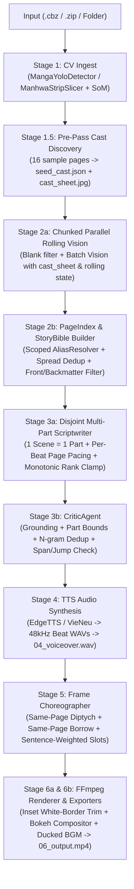

# AGENTS.md — Manga Recap Generator Architecture & Engineering Rules

> Tài liệu chuẩn hóa kiến trúc, cấu trúc filesystem, luồng dữ liệu (workflow) và quy tắc bất biến dành cho mọi AI Agent và kỹ sư phát triển dự án `manga_recap_generator`.

---

## 1. Mô Tả Dự Án & Mục Tiêu Cốt Lõi

**Manga Recap Generator** là hệ thống pipeline tự động đầu-cuối (End-to-End Pipeline) chuyển đổi tập truyện tranh (**Manga** đọc phải-sang-trái hoặc **Manhwa/Webtoon** cuộn dọc, định dạng thư mục ảnh hoặc file nén `.cbz`/`.zip`) thành **video tóm tắt/review hoàn chỉnh (`.mp4` H.264 + Stereo AAC 48kHz)** bằng giọng đọc tiếng Việt tự nhiên, kèm phụ đề `.srt`, bản nháp CapCut và trang HTML preview.

### Mục tiêu kỹ thuật cốt lõi
1. **Đồng bộ Hình - Tiếng tuyệt đối (Strict Visual-Audio Grounding)**: Mỗi câu thuyết minh trong một beat chỉ kể đúng hành động/hội thoại của các khung tranh (`panel_ids`) đang hiển thị trên màn hình (phạm vi 1–3 trang liền kề, tiến đơn điệu theo chiều đọc, không kể vượt trước hình và không mượn panel từ các trang chưa kể).
2. **Không lặp nội dung & Không rò rỉ phụ lục (Zero Content Duplication & Clean Filtering)**: Phân hoạch kịch bản thành các hồi (Part) tách biệt tuyệt đối theo từng Scene (`1 Scene = 1 Part`), loại bỏ tự động trang bìa, trang trắng, mục lục, trang đơn bị cắt trùng từ trang đôi (Double-Page Spread) và phần ngoại truyện/lời bạt cuối tập.
3. **Tổng quát hóa 100% cho mọi bộ truyện (Zero Series-Specific Overfitting)**: Toàn bộ thuật toán thị giác máy tính (CV), xử lý ngôn ngữ và System Prompt hoạt động dựa trên bất biến cấu trúc (structural invariants) và đặc trưng hình ảnh/văn bản tổng quát, tuyệt đối không chứa tên nhân vật, câu thoại hay ngưỡng chỉ số trang cứng của bất kỳ bộ truyện cụ thể nào.

---

## 2. Cấu Trúc Filesystem & Đặc Tả Chi Tiết Từng File

```text
manga_recap_generator/
├── AGENTS.md                        # Đặc tả kiến trúc, filesystem, workflow và quy tắc bắt buộc cho AI Agents
├── config.yaml                      # Cấu hình trung tâm của toàn bộ pipeline (LLM, CV, Script, TTS, Render, Exporters)
├── pyproject.toml                   # Khai báo dependencies Python (quản lý qua uv) và cấu hình pytest/ruff
├── uv.lock                          # Khóa phiên bản chính xác của toàn bộ gói phụ thuộc
├── .env.example                     # Mẫu biến môi trường (OPENAI_API_KEY, OPENAI_BASE_URL, VISION_API_KEY...)
├── .gitignore                       # Quy tắc loại trừ file tạm, virtualenv, model weights và dữ liệu chạy job lớn
│
├── configs/
│   └── personas.yaml                # Định nghĩa System Prompt và thông số giọng kể (kich_tinh, hai_huoc, phan_tich)
│
├── assets/
│   └── bgm/
│       └── default_dark_fantasy.wav # Nhạc nền stereo 48kHz tự động tổng hợp (loop 64s không bản quyền) dùng khi trộn âm
│
├── models/
│   └── manga109_yolo/               # Chứa model ONNX YOLOv11 nhận diện khung tranh (frame), mặt (face), người (body), chữ (text)
│
├── src/
│   ├── __init__.py
│   ├── cli.py                       # Giao diện dòng lệnh (Typer CLI): lệnh `run`, `download`, `inspect`
│   ├── config.py                    # Pydantic schemas cho AppConfig, nạp config.yaml kết hợp ghi đè từ .env
│   ├── pipeline.py                  # Bộ điều phối 6 Stage (MangaRecapPipeline) kèm checkpointing & telemetry
│   │
│   ├── core/
│   │   ├── protocols.py             # Định nghĩa typing Protocol cho Detector, TTSBackend, Renderer, Exporter
│   │   ├── registry.py              # Lớp PluginRegistry tổng quát hóa cơ chế đăng ký các backend theo tên
│   │   └── telemetry.py             # Theo dõi thời gian chạy từng stage, số lượng token, chi phí và cảnh báo lỗi LLM
│   │
│   ├── schemas/
│   │   ├── ingestion.py             # Schemas Stage 1: BBox, FocalPoint, PanelInfo, PageInfo, ChapterInfo, JobManifest
│   │   ├── analysis.py              # Schemas Stage 2: PanelAnalysis, PageAnalysis, CharacterProfile, ChapterSummary, StoryBible
│   │   ├── script.py                # Schemas Stage 3: ScriptBeat, RecapScript, CriticIssue, CriticReport
│   │   └── timeline.py              # Schemas Stage 4-5: AudioBeatInfo, AudioManifest, TimelineShot, SubtitleCue, VideoTimeline
│   │
│   ├── llm/
│   │   └── client.py                # LLMClient tương thích OpenAI API: hỗ trợ tách provider text/vision, circuit breaker, ép kiểu Pydantic JSON
│   │
│   ├── cv/
│   │   ├── registry.py              # DETECTOR_REGISTRY quản lý các bộ cắt khung tranh
│   │   ├── loader.py                # Giải nén file .cbz/.zip hoặc đọc thư mục ảnh, sắp xếp natural sort theo chương/trang
│   │   ├── manga_detector.py        # MangaYoloDetector (ONNX): phát hiện frame/face/body/text, lọc mảnh rác, sắp xếp thứ tự đọc RTL/LTR
│   │   ├── manhwa_slicer.py         # ManhwaStripSlicer: cắt dải ảnh dọc webtoon dựa trên độ lệch chuẩn dòng (gutter detection)
│   │   ├── som.py                   # Vẽ nhãn Set-of-Mark ([P1], [P2]...) lên trang truyện phục vụ Vision LLM ở Stage 2a
│   │   └── stage.py                 # Điều phối Stage 1 (`run_stage1_ingest`), tự động chọn MangaYoloDetector hoặc ManhwaStripSlicer
│   │
│   ├── agents/
│   │   ├── page_analyzer.py         # Stage 1.5 & 2a: Pre-Pass tìm nhân vật chuẩn + ghép `cast_sheet.jpg`; lọc trang trắng (`np.std < 4.5`); đọc ảnh theo lô song song có gối ngữ cảnh (Chunked Parallel Rolling Vision)
│   │   ├── page_index.py            # Stage 2b: Chuẩn hóa bí danh nhân vật (chống lộ spoiler bằng scoped_map); lọc trang đôi cắt trùng bằng so khớp ảnh `96x144`; lọc frontmatter/backmatter theo trạng thái; dựng cây `PageIndexTree`, `StoryBible` và `MEMORY.md`
│   │   ├── story_bible.py           # Tiện ích truy vấn và hợp nhất hồ sơ nhân vật StoryBible
│   │   ├── scriptwriter.py          # Stage 3a: Biên kịch 3 tầng (Fast-path / Disjoint Multi-Part / Rolling Lookup) với phân hoạch `1 Scene = 1 Part`, bảng phân bổ trang theo từng beat và bộ lọc khóa thứ tự panel đơn điệu
│   │   ├── critic.py                # Stage 3b: Kiểm định kịch bản (panel grounding, biên giới Part, khoảng trống trang, nhảy lùi trang, ôm quá 4 trang, trùng lặp nội dung N-gram, từ sáo rỗng AI)
│   │   └── choreographer.py         # Stage 5: Đạo diễn hình ảnh — ghép diptych cùng trang, mượn panel cùng trang, chia thời lượng shot theo độ dài câu đọc, tính quỹ đạo camera Ken Burns và chia phụ đề
│   │
│   ├── audio/
│   │   ├── registry.py              # TTS_REGISTRY quản lý các engine tổng hợp giọng nói
│   │   ├── base.py                  # Xử lý hash cache theo từng beat, đọc thời lượng WAV và nối file `04_voiceover.wav` kèm khoảng nghỉ
│   │   ├── edge_tts_backend.py      # Backend Microsoft Edge TTS tiếng Việt (`vi-VN-NamMinhNeural`) chuyển đổi về chuẩn WAV PCM 48kHz
│   │   ├── vieneu_tts.py            # Backend VieNeu TTS nội bộ (tùy chọn)
│   │   ├── bgm_generator.py         # Tự động tổng hợp nhạc nền Dark Fantasy âm giai Rê thứ (D-minor) stereo 48kHz nếu chưa có file BGM
│   │   └── stage.py                 # Điều phối Stage 4 (`run_stage4_audio`)
│   │
│   ├── render/
│   │   ├── registry.py              # RENDERER_REGISTRY quản lý các bộ kết xuất video
│   │   ├── compositor.py            # Kết xuất từng frame OpenCV: nền mờ bokeh 1/4, bóng đổ, khung đôi diptych RTL, chuyển động pan/zoom/shake
│   │   ├── subtitles.py             # Xuất file `.srt` và vẽ hộp phụ đề tiếng Việt UTF-8 bo góc có bộ nhớ đệm RGBA pre-multiplied
│   │   ├── preview_html.py          # Tạo trình xem nhanh timeline trên trình duyệt
│   │   └── ffmpeg_renderer.py       # Kết xuất MP4 đa luồng qua pipe FFmpeg (tự nhận diện phần cứng VAAPI hoặc libx264), tự cắt viền trắng thừa (`_trim_excess_white_border`) và trộn BGM sidechain ducking
│   │
│   ├── exporters/
│   │   ├── registry.py              # EXPORTER_REGISTRY quản lý các định dạng xuất phụ trợ
│   │   ├── srt_exporter.py          # Xuất phụ đề chuẩn SubRip (`.srt`)
│   │   ├── capcut_draft.py          # Xuất project `draft_content.json` mở trực tiếp trong CapCut Desktop
│   │   └── html_preview.py          # Xuất bảng storyboard HTML tĩnh để kiểm tra nhanh
│   │
│   └── downloaders/
│       └── nyaa.py                  # Tìm kiếm và tải torrent/magnet manga từ Nyaa
│
└── tests/
    ├── test_schemas_and_json.py     # Kiểm thử hình học BBox và tuần tự hóa Pydantic schemas
    ├── test_config_and_registry.py  # Kiểm thử nạp config.yaml, personas.yaml, plugin registries và BGM generator
    ├── test_cv.py                   # Kiểm thử sắp xếp khung RTL/LTR, cắt dải Manhwa, YOLO detector và vẽ nhãn SoM
    ├── test_page_index_and_agents.py# Kiểm thử circuit breaker, provider routing, lọc trang trắng/bìa/trang đôi trùng, PageIndex 2-3 tầng, Scriptwriter, Critic N-gram/backward jump và quét chống overfitting toàn codebase
    ├── test_audio.py                # Kiểm thử ghép nối âm thanh WAV theo từng beat và tính thời lượng
    ├── test_renderer_and_exporters.py# Kiểm thử cắt viền trắng inset panel, khóa diptych/borrow cùng trang, render MP4 stereo + ducked BGM và exporters
    └── test_downloader.py           # Kiểm thử phân tích Nyaa ID, lọc tập truyện và giải nén CBZ
```

### Cấu trúc thư mục dữ liệu đầu ra của mỗi Job (`jobs/<job_id>/`)

Mỗi lần chạy pipeline trên một đầu vào sẽ lưu toàn bộ trạng thái trung gian (checkpoint) tại `jobs/<job_id>/` để có thể chạy tiếp (resume) mà không tốn lại chi phí gọi Vision/Text LLM:

| Đường dẫn trong `jobs/<job_id>/` | Stage tạo | Nội dung & Vai trò |
|---|---|---|
| `extracted/ch01/p0001.jpg...` | Stage 1 | Ảnh gốc từng trang giải nén từ `.cbz`/`.zip` theo thứ tự tự nhiên. |
| `panels/ch01_p001_P1.jpg...` | Stage 1 | Ảnh cắt rời của từng khung tranh (panel) đã lọc bỏ mảnh rác. |
| `som/ch01_p001_som.jpg...` | Stage 1 | Ảnh trang truyện đã đóng dấu Set-of-Mark (`[P1]`, `[P2]`...) kèm viền màu. |
| `01_manifest.json` | Stage 1 | `JobManifest`: tọa độ `BBox`, kích thước trang/panel và danh sách `focal_points` (`face`, `body`, `text`). |
| `repo/seed_cast.json` | Stage 1.5 | Danh sách nhân vật cốt lõi phát hiện từ 16 trang mẫu kèm câu thoại bằng chứng (`evidence_quote`). |
| `repo/cast_sheet.jpg` | Stage 1.5 | Bảng ghép ảnh chân dung khuôn mặt + tên chuẩn của các nhân vật chính để đính kèm vào mọi lệnh gọi Vision. |
| `02a_pages/ch01_p001.json...` | Stage 2a | Cache kết quả phân tích Vision (`PageAnalysis`) của từng trang riêng lẻ. |
| `02a_all_pages.json` | Stage 2a | Danh sách gộp toàn bộ `PageAnalysis` của tập truyện theo đúng thứ tự trang. |
| `repo/notes/scene_001.md...` | Stage 2b | Ghi chú Markdown siêu gọn của từng Scene (~20 trang truyện/scene), lưu đủ mọi `panel_id`, tỷ lệ khung `ar`, cờ `face+text` và lời thoại. |
| `repo/tree_index.json` | Stage 2b | Cây mục lục phân cấp `PageIndexTree` (2 tầng `Root -> Scenes` hoặc 3 tầng `Root -> Arcs -> Scenes`) kèm danh sách `skipped_pages`. |
| `02b_story_bible.json` | Stage 2b | Hồ sơ toàn cục `StoryBible` (tên chuẩn, bí danh, ngoại hình, vai trò, mối quan hệ, mạch cốt truyện). |
| `repo/MEMORY.md` | Stage 2b | Sổ tay nhân vật dạng Markdown nạp vào mọi lượt viết kịch bản để giữ thống nhất cách gọi tên. |
| `repo/OUTLINE.json` | Stage 3a | Dàn ý `ScriptOutline` chia tập truyện thành các `OutlinePart` tách biệt (`1 Scene = 1 Part`). |
| `repo/script/parts/part_01.json...` | Stage 3a | Cache danh sách `ScriptBeat` của từng hồi (Part). |
| `repo/script/part_boundaries.json` | Stage 3a | Ranh giới beat (`start_beat_idx..end_beat_idx`) và tập `allowed_panels` hợp lệ của từng Part. |
| `03a_script_draft.json` | Stage 3a | Bản thảo kịch bản gộp từ tất cả các Part (`RecapScript`). |
| `03b_script_final.json` | Stage 3b | Kịch bản chính thức sau khi `CriticAgent` kiểm định và chuẩn hóa `panel_ids`. |
| `03b_critic_report.json` | Stage 3b | Báo cáo chấm điểm chất lượng kịch bản (`score`, `passed`, danh sách `issues`). |
| `audio/beats/*.wav` | Stage 4 | File âm thanh giọng đọc PCM 48kHz của từng beat (đặt tên theo mã băm nội dung để tái sử dụng khi sửa lẻ beat). |
| `04_voiceover.wav` | Stage 4 | File âm thanh giọng đọc tổng hợp toàn bộ video. |
| `04_audio_manifest.json` | Stage 4 | Mốc thời gian bắt đầu/kết thúc (`start_ms`, `end_ms`, `pause_after_ms`) chính xác tới từng mili-giây của mỗi beat. |
| `05_timeline.json` | Stage 5 | Kịch bản phân cảnh chi tiết `VideoTimeline` gồm danh sách `shots` (panel đơn/đôi, quỹ đạo camera, hiệu ứng chuyển cảnh) và `subtitles`. |
| `06_subtitles.srt` | Stage 6 | File phụ đề tiếng Việt chuẩn SRT. |
| `06_output.mp4` | Stage 6a | Video thành phẩm H.264 (`1280x720@24fps`) + âm thanh Stereo AAC 48kHz đã trộn nhạc nền ducking. |
| `exports/` | Stage 6b | Chứa project CapCut (`capcut_draft/draft_content.json`) và trang `preview.html`. |
| `telemetry.json` | Toàn cục | Thống kê thời gian thực thi từng stage, số lần gọi model, tổng lượng token và cảnh báo. |

---

## 3. Kiến Trúc & Workflow Tổng Quát (6-Stage Pipeline)



### Đặc tả chi tiết luồng xử lý từng Stage

#### Stage 1 — CV Ingestion (`src/cv/`)
1. **Giải nén & Định dạng**: `collect_chapters()` giải nén `.cbz`/`.zip` hoặc quét thư mục ảnh theo thứ tự tự nhiên (`natural_sort_key`). Nếu tỷ lệ chiều cao/chiều rộng `h / w >= 2.2`, hệ thống tự động chọn `ManhwaStripSlicer` (cắt theo khoảng trắng ngang có `row_std < 6.0`); ngược lại chọn `MangaYoloDetector`.
2. **Phát hiện & Lọc khung tranh**: `MangaYoloDetector` chạy ONNX YOLO phát hiện 4 lớp: `frame`, `face`, `body`, `text`. Loại bỏ các mảnh viền rác quá nhỏ (`min_side < 95px`), dải screentone trống không có mặt người/chữ hoặc độ tương phản quá thấp (`crop_std < 18.0`).
3. **Sắp xếp thứ tự đọc & Đóng dấu SoM**: Hàm `sort_panels_reading_order()` gom nhóm các khung tranh theo hàng ngang (dựa trên độ chồng lấp trục dọc `> 35%`) rồi sắp xếp từ phải sang trái (`rtl`) cho Manga hoặc trái sang phải (`ltr`). Cuối cùng, `render_som_page()` vẽ nhãn `[P1]..[Pn]` lên trang để tạo ảnh trong `som/`.

#### Stage 1.5 & 2a — Pre-Pass Cast Discovery & Rolling Vision (`src/agents/page_analyzer.py`)
1. **Lọc trang trắng tuyệt đối bằng CV**: Trước mọi lệnh gọi Vision, `_is_blank_or_solid_page()` kiểm tra độ lệch chuẩn mức xám `np.std(img) < 4.5`. Nếu là trang giấy trắng/đen trơn, hệ thống trả về ngay bản ghi `[PHỤ LỤC] Trang trắng` mà không gọi Vision LLM, triệt tiêu hoàn toàn nguy cơ Vision tự bịa cốt truyện lên trang trắng.
2. **Khóa bảng nhân vật chuẩn (`cast_sheet.jpg`)**: `_select_prepass_pages()` chọn 16 trang có mật độ khuôn mặt và bóng thoại cao nhất trải đều qua 6 phân vùng của tập truyện để quét nhanh tên nhân vật có câu thoại bằng chứng (`evidence_quote`), hợp nhất qua `PrePassCastMerger` và cắt ảnh chân dung khuôn mặt ghép thành `repo/cast_sheet.jpg`.
3. **Phân tích Vision song song có gối ngữ cảnh**: Các trang chưa có trong cache được chia thành các chunk liên tiếp chạy song song (`Chunked Parallel Rolling`). Mỗi batch 4 trang luôn được đính kèm ảnh `cast_sheet.jpg` ở vị trí đầu tiên cùng trạng thái `RollingSceneState` (nhân vật đang có mặt và tóm tắt 3 trang liền trước) để nhận diện nhất quán tên nhân vật xuyên suốt cả tập.

#### Stage 2b — PageIndex Tree & StoryBible (`src/agents/page_index.py`)
1. **Chuẩn hóa bí danh có phạm vi (`_resolve_character_aliases`)**: Hợp nhất tên gọi tắt và họ tên đầy đủ về `canonical_name`. Quy tắc cấu trúc bắt buộc: mọi nhãn mô tả tạm thời (bắt đầu bằng `[` hoặc chứa `"chưa rõ"`, `"bí ẩn"`, `"người lạ"`) chỉ được ánh xạ cục bộ trong `scoped_map` theo đúng `page_ids` được chỉ định, tuyệt đối không đưa vào `global_map` toàn cục — giúp chống lộ danh tính (spoiler) cho nhân vật bí ẩn ở các chương đầu.
2. **Khử trang đơn cắt trùng từ trang đôi (`_detect_duplicate_spread_pages`)**: Tự động phát hiện các trang đôi dàn ngang (`width > height * 1.15`) có 2 trang dọc kế tiếp là bản cắt nửa trái/phải. Thuật toán cắt đôi ảnh trang ngang, thu nhỏ về `96x144` grayscale và tính sai số tuyệt đối trung bình (MAE) với 2 trang đơn kế tiếp theo cả chiều RTL và LTR; nếu `min(rtl_diff, ltr_diff) < 12.0` thì đưa 2 trang đơn trùng vào `skipped_pages`.
3. **Lọc Frontmatter & Backmatter theo máy trạng thái (`_filter_story_pages`)**:
   - Khi danh sách `story` còn rỗng (`not story`), `_is_frontmatter_page()` loại bỏ trang bìa, trang lót, mục lục, hoặc trang minh họa 1-panel không có lời thoại mà không dùng bất kỳ hằng số giới hạn chỉ số trang nào. Ngay khi gặp trang truyện thật đầu tiên, `story` khác rỗng và bộ lọc Frontmatter tự động đóng.
   - Mọi trang có tiền tố `[phụ lục]` hoặc khớp từ khóa xuất bản cuối sách (`_BACKMATTER_KEYWORDS`) sau khi truyện đã bắt đầu đều được đưa vào `skipped_pages`.
4. **Dựng cây mục lục & Sổ tay nhân vật**: Gom các trang truyện thật thành các `SceneNode` (~20 trang/scene), tóm tắt song song qua `PageIndexSceneSummarizer` (tự động nâng lên cây 3 tầng `Root -> Arcs -> Scenes` nếu tập truyện có `> 40` scenes) và sinh `02b_story_bible.json` cùng `repo/MEMORY.md`.

#### Stage 3a — Disjoint Multi-Part Scriptwriter (`src/agents/scriptwriter.py`)
1. **Phân hoạch `1 Scene = 1 Part` tách biệt tuyệt đối**: Trong `_plan_outline()`, mỗi `SceneNode` được ánh xạ 1-1 thành một `OutlinePart` (chỉ gộp scene cuối nếu `< 5` trang). Ngân sách `target_beats` và `target_words` của mỗi Part được tính tỷ lệ thuận chính xác với số trang của Scene đó (~6–7 beats cho mỗi scene 18–20 trang). Không có sự chồng lấn trang giữa hai Part và không dùng cơ chế cắt đuôi `handoff` gây kể lặp.
2. **Bảng phân bổ trang theo từng Beat (Per-Beat Page Pacing Guide)**: Trước khi gọi LLM viết mỗi Part, `_write_part_with_lookup()` chia đều danh sách trang của Part đó cho `target_beats` (ví dụ: mỗi beat phụ trách 2–3 trang cụ thể) và đưa bảng phân bổ vào prompt, buộc LLM đi đều đến trang cuối cùng của Part mà không dồn 10–15 trang cuối vào một beat.
3. **Khóa thứ tự Panel đơn điệu (`_sanitize_part_beats`)**: Sau khi LLM trả về danh sách beats của Part, bộ lọc hậu kiểm giữ lại các `panel_id` thuộc `allowed_set`, ép con trỏ `cursor_rank` tiến đơn điệu về phía trước (cấm nhảy lùi trang) và kẹp độ rộng mỗi beat tối đa trong phạm vi `<= 3` trang truyện liền kề.

#### Stage 3b — Critic Verification (`src/agents/critic.py`)
`CriticAgent.review()` kiểm định tự động toàn bộ kịch bản trên 6 tiêu chí cấu trúc:
1. **Panel Grounding**: Mọi `panel_id` phải tồn tại trong `01_manifest.json`; nếu sai sẽ thay bằng panel hợp lệ kế tiếp theo vị trí tương đối (`_scoped_fallback_panel`).
2. **Part Boundary Compliance**: Kiểm tra từng beat có tham chiếu panel vượt ra ngoài tập `allowed_panels` của Part đó trong `part_boundaries.json` hay không.
3. **Single-Beat Page Span**: Cảnh báo nếu một beat đơn lẻ ôm các panel trải rộng quá 4 trang (`cur_max - cur_min > 4`).
4. **Monotonic Page Progression**: Cảnh báo nếu beat sau nhảy lùi về trang trước beat liền kề (`cur_min < prev_page_pos`).
5. **Coverage Gap**: Cảnh báo nếu hai beat liên tiếp bỏ cách quá 10 trang truyện (`cur_min - prev_page_pos > 10`).
6. **Cross-Beat Content Duplication & Style**: Dùng `_content_ngrams()` (tập hợp 2-grams và 3-grams từ chuẩn hóa) để phát hiện hai beat bất kỳ trùng lặp nội dung (`overlap >= 4` và tỷ lệ trùng `>= 35%`), đồng thời quét danh sách cụm từ sáo rỗng AI (`_BANNED_CLICHES`).

#### Stage 4 — TTS Audio Synthesis (`src/audio/`)
`run_stage4_audio()` băm nội dung từng beat (`beat_cache_key`) để tổng hợp giọng đọc tiếng Việt qua `EdgeTTSBackend` (hoặc `VieNeuTTSBackend`), chuẩn hóa về WAV PCM 48kHz, ghép nối toàn bộ các beat kèm khoảng lặng `pause_after_ms` thành `04_voiceover.wav` và xuất bảng định thời chính xác `04_audio_manifest.json`.

#### Stage 5 — Frame Choreographer (`src/agents/choreographer.py`)
1. **Khử lặp giáp ranh & Lọc mảnh hẹp**: Loại bỏ các panel hẹp thiếu mặt người/chữ (`_is_good_visual_panel`) và bỏ panel đầu của beat mới nếu trùng với panel cuối cùng của beat liền trước (`dedup_cross`).
2. **Mượn thêm Panel nội bộ trong cùng trang (`beat_pages`)**: Khi thời lượng đọc của beat dài hơn `len(pids) * max_shot_duration_ms`, Choreographer chỉ được phép mượn thêm panel chưa dùng nằm trên **cùng các trang của beat đó (`cand.page_id in beat_pages`)** và không thuộc beat kế tiếp — đảm bảo hình ảnh không bao giờ trôi sang các trang chưa được thuyết minh.
3. **Ghép khung đôi Diptych cùng trang**: Hai panel dọc liên tiếp (`0.18 <= ar < 0.72`) chỉ được ghép cạnh nhau theo chiều đọc RTL khi chúng thuộc **cùng một trang (`p1.page_id == p2.page_id`)**.
4. **Chia thời lượng Shot theo độ dài câu đọc**: Tách `narration_vi` thành các câu và phân bổ thời lượng hiển thị của từng shot (`slot_durations`) tỷ lệ thuận với độ dài ký tự của câu tương ứng.

#### Stage 6a & 6b — Video Renderer & Exporters (`src/render/`, `src/exporters/`)
1. **Tự cắt viền trắng thừa trên trang Inset (`_trim_excess_white_border`)**: Với các khung tranh nằm lọt thỏm giữa trang giấy trắng (`> 75%` diện tích ảnh có độ sáng `> 245` và vùng mực in chiếm `5%..60%` diện tích), renderer tự động crop về đúng hộp bao vùng mực kèm lề `6%` để hình ảnh hiển thị to, rõ trên khung 16:9.
2. **Kết xuất đa luồng & Trộn BGM Ducking**: `FFmpegOpenCVRenderer` chia các cụm frame theo từng shot, dựng hình song song bằng `ThreadPoolExecutor` (nền mờ bokeh + bóng đổ + phụ đề pre-multiplied alpha) và đẩy trực tiếp qua `stdin` của FFmpeg (ưu tiên mã hóa phần cứng `h264_vaapi` nếu có `/dev/dri/renderD128`, fallback về `libx264`). Luồng âm thanh sử dụng bộ lọc `sidechaincompress` của FFmpeg để tự động hạ nhỏ nhạc nền (`default_dark_fantasy.wav`) mỗi khi có giọng thuyết minh.

---

## 4. Đánh Giá File `RULES.md` Trong Workspace

File `RULES.md` (`110 KB`, ~909 dòng, tiêu đề *"The Elements of Agent Style — Rules"*) là bộ quy tắc viết **bài báo khoa học Machine Learning bằng tiếng Anh** theo phong cách cá nhân của tác giả Yue Zhao (quy định cách viết Abstract, Introduction, LaTeX `\section`, báo cáo khoảng tin cậy CI/p-value trên tập dữ liệu ImageNet/MS MARCO, viết hoa Title Case cho tiêu đề tiếng Anh, v.v.).

- **Mức độ phù hợp với dự án**: **90% nội dung trong `RULES.md` là Out-of-Context (lệch ngữ cảnh)** đối với dự án `manga_recap_generator` (vốn là hệ thống xử lý ảnh Manga + sinh kịch bản văn nói tiếng Việt cho YouTube). Việc nạp file `110 KB` này vào context của Agent trong các phiên làm việc sẽ làm tốn ~28.000 tokens vô ích và thậm chí gây nhiễu (ví dụ: quy tắc cấm viết tắt hay quy tắc học thuật tiếng Anh đối lập với yêu cầu văn nói đời thường tiếng Việt của kịch bản video).
- **10% nguyên lý có giá trị đã được chắt lọc trực tiếp vào dự án**:
  1. Đặt chỉ dẫn dạng phủ định kèm cặp ví dụ đối chiếu **XẤU (CẤM) vs TỐT** (đã tích hợp vào `configs/personas.yaml`).
  2. Cấm các cụm ẩn dụ chết / từ sáo rỗng AI (đã tích hợp thành danh sách `_BANNED_CLICHES` trong `src/agents/critic.py`).
  3. Giữ nhất quán thuật ngữ và tên thực thể sau khi định nghĩa (đã thực thi qua `StoryBible`, `MEMORY.md` và `_resolve_character_aliases`).
- **Quy định cho AI Agents**: **KHÔNG đọc hoặc nạp `RULES.md` vào context khi làm việc trên codebase này**; mọi quy tắc thiết kế và văn phong của dự án đều đã được quy định đầy đủ ngay trong `AGENTS.md` và `.agents/rules/`.

---

## 5. Quy Tắc Kỹ Thuật Bắt Buộc (Mandatory Engineering Rules)

Mọi AI Agent và lập trình viên khi làm việc trên repository này **BẮT BUỘC** tuân thủ nghiêm ngặt 3 quy tắc bất biến sau:

### Quy tắc 1: Bắt buộc cập nhật `AGENTS.md` khi thay đổi Workflow hoặc Filesystem (`AGENTS.md` Sync Rule)
- Bất kỳ khi nào bạn thêm, xóa, đổi tên hoặc di chuyển file/thư mục trong `src/`, `configs/`, `tests/`, hoặc thay đổi kiến trúc Stage, luồng dữ liệu, tên file checkpoint trong `jobs/<job_id>/`, bạn **BẮT BUỘC phải cập nhật lại Mục 2 (Filesystem Structure) và Mục 3 (Kiến trúc & Workflow) của file `AGENTS.md` này trong cùng một lượt sửa đổi**.
- Không một thay đổi kiến trúc hoặc cấu trúc file nào được phép coi là hoàn tất nếu `AGENTS.md` chưa phản ánh đúng trạng thái thực tế của mã nguồn.

### Quy tắc 2: Tuyệt đối cấm Anti-Pattern Overfit & Hardcode thiếu tính tổng quát (Zero Overfitting Rule)
- **Cấm đưa dữ liệu đặc thù của một bộ truyện vào code hoặc prompt**: Tuyệt đối không dùng tên nhân vật, tên tổ chức, địa danh, câu thoại mẫu hay tình tiết của bất kỳ bộ truyện cụ thể nào (như *Pandora Hearts*, *One Piece*, v.v.) trong `src/`, `configs/` hay `config.yaml`.
- **Cấm dùng ngưỡng chỉ số trang/vị trí cứng (Magic Index Cutoffs) để vá lỗi**:
  - Không dùng các điều kiện kiểu `idx < 6`, `idx in (0, 2, 3, 4)`, `idx >= int(total * 0.85)`, `range(7, ..., 8)` để đoán vị trí trang bìa, trang trắng, phụ lục hay ranh giới chuyển hồi.
  - Không viết biến đếm riêng cho một từ đơn lẻ (như `blood_count` cho từ `"đẫm máu"`).
- **Giải pháp bắt buộc**: Mọi bộ lọc và thuật toán phải dựa trên **trạng thái cấu trúc (state machine)**, **đặc trưng hình học/điểm ảnh tổng quát** (`np.std`, tỷ lệ khung hình `ar`, sai số điểm ảnh MAE giữa trang đôi và trang đơn, tỷ lệ nền trắng) hoặc **thuật toán ngôn ngữ tổng quát** (đối sánh N-gram, scoped alias resolution).
- Mọi thay đổi phải vượt qua bài kiểm thử tự động `test_no_series_specific_overfitting_in_codebase` trong `tests/test_page_index_and_agents.py`.

### Quy tắc 3: Quy trình Kiểm thử & Git Commit theo từng tính năng (Atomic Feature Commit Rule)
- Repository này được quản lý phiên bản bằng **Git**.
- Mỗi khi hoàn thành việc thêm mới, sửa lỗi hoặc thay đổi một tính năng:
  1. Bắt buộc chạy toàn bộ bộ kiểm thử bằng lệnh `uv run pytest` và đảm bảo **100% test cases đều PASS** (kèm bổ sung unit test mới nếu thêm logic mới).
  2. Kiểm tra `AGENTS.md` đã được cập nhật đồng bộ (nếu có thay đổi file/workflow theo Quy tắc 1).
  3. Thực hiện **`git commit` ngay lập tức** cho tính năng/sửa đổi đó với thông điệp rõ ràng theo chuẩn Conventional Commits (`feat: ...`, `fix: ...`, `refactor: ...`, `docs: ...`, `test: ...`), tuyệt đối không để dồn nhiều tính năng không liên quan vào một commit hoặc bỏ quên không commit sau khi hoàn tất.
