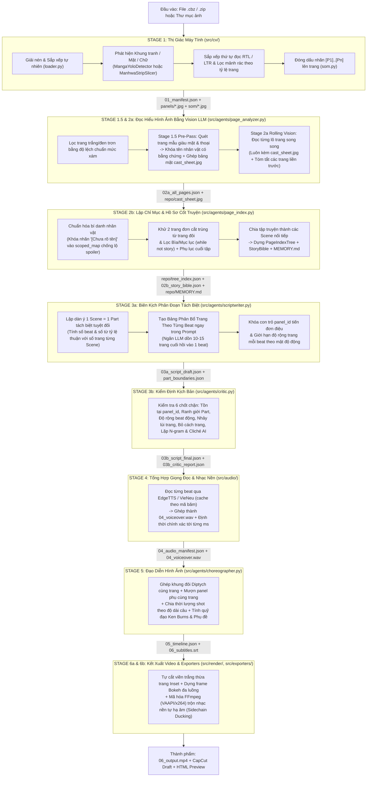

# Kiến Trúc Chi Tiết Dự Án Manga Recap Generator (`docs/ARCHITECTURE.md`)

> Tài liệu giải thích toàn diện kiến trúc hệ thống bằng tiếng Việt dễ hiểu — từ bức tranh tổng thể đến từng trạm xử lý, hợp đồng dữ liệu, triết lý chống "con số thần bí" (magic numbers) và bảng kiểm tra tác động khi sửa đổi kiến trúc.

---

## Mục Lục (Table of Contents)

1. [Bức Tranh Tổng Thể: Hệ Thống Này Làm Gì?](#1-bức-tranh-tổng-thể-hệ-thống-này-làm-gì)
2. [Tại Sao Vẫn Còn "Con Số" & Làm Sao Để Hệ Thống Tổng Quát Thật Sự?](#2-tại-sao-vẫn-còn-con-số--làm-sao-để-hệ-thống-tổng-quát-thật-sự)
3. [Sơ Đồ Luồng Dữ Liệu 6 Trạm (6-Stage Pipeline)](#3-sơ-đồ-luồng-dữ-liệu-6-trạm-6-stage-pipeline)
4. [Giải Thích Chi Tiết Từng Trạm Xử Lý (Stage 1 → Stage 6)](#4-giải-thích-chi-tiết-từng-trạm-xử-lý-stage-1--stage-6)
   - [4.1. Stage 1 — Đọc Truyện & Cắt Khung Tranh (`src/cv/`)](#41-stage-1--đọc-truyện--cắt-khung-tranh-srccv)
   - [4.2. Stage 1.5 & 2a — Nhận Diện Khuôn Mặt & Đọc Hiểu Từng Trang (`src/agents/page_analyzer.py`)](#42-stage-15--2a--nhận-diện-khuôn-mặt--đọc-hiểu-từng-trang-srcagentspage_analyzerpy)
   - [4.3. Stage 2b — Lọc Trang Rác, Chống Spoiler & Lập Hồ Sơ Cốt Truyện (`src/agents/page_index.py`)](#43-stage-2b--lọc-trang-rác-chống-spoiler--lập-hồ-sơ-cốt-truyện-srcagentspage_indexpy)
   - [4.4. Stage 3a — Biên Kịch Phân Đoạn Tách Biệt (`src/agents/scriptwriter.py`)](#44-stage-3a--biên-kịch-phân-đoạn-tách-biệt-srcagentsscriptwriterpy)
   - [4.5. Stage 3b — Kiểm Định Viên Kịch Bản (`src/agents/critic.py`)](#45-stage-3b--kiểm-định-viên-kịch-bản-srcagentscriticpy)
   - [4.6. Stage 4 — Phòng Thu Giọng Đọc & Nhạc Nền (`src/audio/`)](#46-stage-4--phòng-thu-giọng-đọc--nhạc-nền-srcaudio)
   - [4.7. Stage 5 — Đạo Diễn Hình Ảnh & Chia Nhịp Khung Hình (`src/agents/choreographer.py`)](#47-stage-5--đạo-diễn-hình-ảnh--chia-nhịp-khung-hình-srcagentschoreographerpy)
   - [4.8. Stage 6a & 6b — Dựng Video FFmpeg & Xuất Dự Án (`src/render/`, `src/exporters/`)](#48-stage-6a--6b--dựng-video-ffmpeg--xuất-dự-án-srcrender-srcexporters)
5. [Hạ Tầng Dùng Chung: LLM Client, Plugin Registry & Checkpointing](#5-hạ-tầng-dùng-chung-llm-client-plugin-registry--checkpointing)
6. [Bảng Kiểm Tra Tác Động Kiến Trúc (Architecture Impact Checklist — BẮT BUỘC TRA CỨU KHI SỬA CODE)](#6-bảng-kiểm-tra-tác-động-kiến-trúc-architecture-impact-checklist--bắt-buộc-tra-cứu-khi-sửa-code)

---

## 1. Bức Tranh Tổng Thể: Hệ Thống Này Làm Gì?

Hãy hình dung quy trình của một biên tập viên con người khi làm video **Review / Tóm tắt Truyện Tranh (Manga/Manhwa)** trên YouTube:
1. Mở cuốn truyện ra, bỏ qua bìa, trang trắng, mục lục và phần lời bạt cuối sách.
2. Cắt từng ô tranh (panel) trên mỗi trang theo đúng thứ tự đọc (từ phải sang trái với Manga Nhật, hoặc từ trên xuống dưới với Manhwa Hàn).
3. Nhớ mặt các nhân vật chính để không gọi nhầm tên người này sang người kia.
4. Đọc hiểu cốt truyện từ đầu đến cuối tập, chia tập truyện thành các cảnh (Scene) nối tiếp nhau.
5. Viết lời bình (voiceover) bằng **văn nói tiếng Việt tự nhiên**, vừa kể đến đâu thì chỉ định đúng ô tranh của cảnh đó để chiếu lên màn hình.
6. Thu âm giọng đọc, ghép ô tranh khớp với câu nói, thêm hiệu ứng lia máy (Ken Burns), chèn phụ đề và trộn nhạc nền tự động nhỏ xuống khi có tiếng người nói.

**Manga Recap Generator** tự động hóa 100% quy trình trên thành một dây chuyền gồm **6 Trạm (6 Stages)**. Đầu vào chỉ là 1 file `.cbz`/`.zip` (hoặc thư mục ảnh), và đầu ra cuối cùng là file video `06_output.mp4` hoàn chỉnh.

### 3 Bài Toán Khó Nhất Mà Kiến Trúc Phải Giải Quyết
- **Bài toán 1 — Lệch hình với tiếng (Frame-to-Script Drift)**: Nếu lời đọc đang kể cảnh ở trang 40 mà màn hình vẫn chiếu hình trang 30 (hoặc ngược lại, chiếu hình trang tương lai chưa kể tới), người xem sẽ thấy video bị loạn.
- **Bài toán 2 — Kể lặp lại sự kiện (Content Duplication)**: Một tập truyện dày ~180–200 trang quá dài để LLM viết kịch bản chi tiết trong 1 lần gọi duy nhất. Nhưng nếu cắt thành nhiều phần (Parts) không khéo, phần sau sẽ kể lặp lại phần đuôi của phần trước.
- **Bài toán 3 — Nhầm tên nhân vật hoặc lộ danh tính sớm (Character Confusion & Identity Spoilers)**: Truyện đen trắng có nhiều nhân vật kiểu tóc giống nhau; hoặc có nhân vật đầu truyện còn giấu mặt ("kẻ áo choàng đỏ"), cuối truyện mới lộ tên thật. Hệ thống không được gọi nhầm, cũng không được làm lộ tên thật ngay từ trang đầu.

---

## 2. Tại Sao Vẫn Còn "Con Số" & Làm Sao Để Hệ Thống Tổng Quát Thật Sự?

Khi nhìn vào một hệ thống xử lý cả **Hình ảnh (Pixels) + Âm thanh (Audio Waveforms) + Ngôn ngữ (LLM)**, câu hỏi quan trọng nhất là: *"Tại sao trong code vẫn xuất hiện những con số? Có phải cứ có số là chưa tổng quát?"*

Câu trả lời nằm ở việc phân biệt rạch ròi **3 tầng bản chất của các con số**:

### Tầng 1: Bất Biến Cấu Trúc & Quan Hệ Logic (Structural Invariants — 0% cần con số)
Ở tầng logic cốt truyện và đồng bộ hình-tiếng, một kiến trúc tốt **tuyệt đối không dùng con số đoán mò**, mà dùng **quan hệ tập hợp và máy trạng thái (State Machine)**:
- **Lọc phần mở đầu (Frontmatter)**: Không đoán *"6 trang đầu là bìa/mục lục"* (`idx < 6` — SAI). Thay vào đó dùng **máy trạng thái `while not story`**: chừng nào chưa gặp trang truyện thật đầu tiên (trang có chia nhiều khung hành động hoặc có hội thoại), mọi trang bìa/mục lục/tranh lót đều bị bỏ qua. Ngay khi gặp trang truyện thật đầu tiên, trạng thái `story` bật lên và khóa bộ lọc mở đầu lại.
- **Phân chia kịch bản không lặp (`1 Scene = 1 Part`)**: Không cắt đuôi phần trước bơm sang phần sau. Tập hợp trang của các Part là **các tập con rời nhau tuyệt đối (Disjoint Sets)**: $Pages(Part_i) \cap Pages(Part_j) = \emptyset$.
- **Khóa mượn hình & ghép khung đôi (Choreographer Invariant)**:
  - Hai khung tranh chỉ được ghép chung 1 màn hình (Diptych) khi `p1.page_id == p2.page_id` (cùng 1 trang).
  - Khi câu thoại dài cần chiếu thêm hình phụ trên trang đó, chỉ được lấy khung tranh thỏa mãn `cand.page_id in beat_pages` (thuộc chính các trang mà beat đó đang kể). Đây là luật tập hợp tuyệt đối, không có bất kỳ con số may rủi nào.
- **Chống lộ Spoiler nhân vật**: Không chặn theo tên nhân vật cụ thể. Mọi nhãn mô tả vô danh (`[Chưa rõ tên: ...]`, `"bí ẩn"`, `"người lạ"`) chỉ được phép ánh xạ cục bộ tại đúng trang nó được giải thích (`scoped_map[(name, page_id)]`), cấm đưa vào từ điển toàn cục (`global_map`).

### Tầng 2: Ranh Giới Vật Lý "Từ Điểm Ảnh / Sóng Âm Sang Ký Hiệu" (Signal-to-Symbol Boundary)
Máy tính nhìn trang truyện ban đầu chỉ là một ma trận hàng triệu con số độ sáng từ `0` (đen) đến `255` (trắng), và nhìn kích thước ảnh là `width x height` pixel. Để chuyển từ **tín hiệu vật lý liên tục** sang **khái niệm rời rạc** ("đây là trang trắng", "đây là trang đôi", "đây là mảnh viền rác"), bắt buộc phải có phép đo hình học/thống kê:
- **Làm sao để không biến phép đo vật lý thành "con số thần bí" (Magic Numbers)?**
  1. **Không bao giờ dùng số Pixel tuyệt đối**: Một khung tranh rộng `100px` là rất nhỏ trên ảnh scan 4K (`3000px`), nhưng lại là khung lớn trên ảnh web (`500px`). Do đó, mọi kích thước hình học bắt buộc phải **chuẩn hóa theo kích thước của chính trang đó** (`ratio = panel_side / min(page_width, page_height)`).
  2. **So sánh bất biến hình học giữa các trang**: Một trang đôi (Double-Page Spread) bị cắt làm 2 trang đơn kế tiếp có bất biến hình học là: trang đôi nằm ngang (`width > height`), hai trang sau nằm dọc (`height > width`), và khi ghép nửa trái + nửa phải của trang đôi đem so với 2 trang đơn trên cùng một lưới thu nhỏ đồng tỷ lệ thì sai số độ sáng giữa chúng xấp xỉ bằng 0 (chỉ lệch nhiễu nén JPEG).
  3. **Mật độ kịch bản tự co giãn theo cầu hình thời lượng**: Một beat ôm bao nhiêu trang không được khóa cứng là `3` hay `4` trang, mà phải tính từ **tỷ lệ mật độ thực tế** `avg_pages_per_beat = total_pages / total_beats`. Nếu người dùng muốn video tóm tắt nhanh 3 phút (ít beat) thì mỗi beat tự động được phép ôm nhiều trang hơn; nếu muốn video chi tiết 15 phút (nhiều beat) thì mỗi beat tự động thu hẹp về 1–2 trang.

### Tầng 3: Thông Số Sản Phẩm Do Người Dùng Chọn (`config.yaml`)
Các con số như độ phân giải video `1280x720`, tốc độ khung hình `24 fps`, tần số âm thanh `48000 Hz`, tốc độ đọc `225 từ/phút`, thời lượng mong muốn `target_duration_min: 11.0` là **đầu vào thiết kế sản phẩm**, được đặt tập trung tại `config.yaml` để người dùng tùy chỉnh, tuyệt đối không viết chìm trong logic code.

---

## 3. Sơ Đồ Luồng Dữ Liệu 6 Trạm (6-Stage Pipeline)

---

## 4. Giải Thích Chi Tiết Từng Trạm Xử Lý (Stage 1 → Stage 6)

### 4.1. Stage 1 — Đọc Truyện & Cắt Khung Tranh (`src/cv/`)
- **Mục đích**: Biến file nén `.cbz`/`.zip` hoặc thư mục ảnh thô thành danh sách các trang và từng ô tranh (panel) đã được cắt rời, đánh số theo đúng thứ tự mắt người đọc.
- **Cách hoạt động**:
  1. `loader.py`: Giải nén và sắp xếp tên file theo thứ tự số tự nhiên (`natural_sort_key`, để `p2` đứng trước `p10`).
  2. `stage.py`: Nhìn hình dáng bức ảnh để tự chọn công cụ:
     - Nếu là dải ảnh dọc dài của **Manhwa/Webtoon** $\rightarrow$ gọi `ManhwaStripSlicer` (`manhwa_slicer.py`) tìm các dải khoảng trắng ngang (gutter) để cắt thành từng khung.
     - Nếu là trang sách **Manga** $\rightarrow$ gọi `MangaYoloDetector` (`manga_detector.py`) chạy mô hình ONNX YOLOv11 để nhận diện 4 loại đối tượng: **khung tranh (`frame`)**, **khuôn mặt (`face`)**, **cơ thể (`body`)** và **cụm chữ (`text`)**.
  3. **Lọc khung rác theo tỷ lệ trang**: Loại bỏ các mảnh viền thừa có kích thước quá nhỏ so với cạnh ngắn của trang (`min(w, h)`) hoặc chỉ chứa nền screentone xám không có mặt người lẫn chữ.
  4. **Sắp xếp chiều đọc**: Gom các khung tranh nằm cùng một hàng ngang rồi xếp từ phải sang trái (`rtl`) cho Manga hoặc trái sang phải (`ltr`).
  5. **Đóng dấu Set-of-Mark (`som.py`)**: Vẽ nhãn `[P1]`, `[P2]`... trực tiếp lên góc từng khung tranh trên trang tổng thể. Nhờ nhãn này, ở Stage 2a mô hình Vision LLM biết chính xác khung nào là `P1`, khung nào là `P2` mà không bị râu ông nọ cắm cằm bà kia.
- **Đầu ra**: File `01_manifest.json`, thư mục ảnh khung rời `panels/*.jpg` và ảnh đóng dấu `som/*_som.jpg`.

---

### 4.2. Stage 1.5 & 2a — Nhận Diện Khuôn Mặt & Đọc Hiểu Từng Trang (`src/agents/page_analyzer.py`)
- **Mục đích**: Đọc nội dung hành động, cảm xúc và lời thoại trong từng khung tranh bằng tiếng Việt, đồng thời giữ nhất quán tên nhân vật từ trang đầu đến trang cuối.
- **Tại sao phải có Stage 1.5 (Pre-Pass Cast Discovery) trước khi đọc từng trang?**
  - Nếu đọc tuần tự từ trang 1 mà không có bảng đối chiếu gương mặt, khi một nhân vật xuất hiện lại ở trang 80 nhưng không được gọi tên trong bóng thoại, Vision LLM rất dễ quên mặt hoặc gọi nhầm sang nhân vật khác.
  - Vì vậy, Stage 1.5 chọn các trang mẫu có nhiều khuôn mặt và lời thoại nhất rải đều khắp tập truyện để quét nhanh danh sách nhân vật chính. Điều kiện tiên quyết: mỗi nhân vật được ghi nhận **bắt buộc phải kèm câu thoại bằng chứng trên trang (`evidence_quote`)** để cấm LLM tự đoán tên từ trí nhớ ngoài truyện.
  - Sau đó, hệ thống cắt ảnh cận cảnh khuôn mặt rõ nhất của từng nhân vật, ghép thành một tấm bảng danh sách có ghi tên bên dưới gọi là **`repo/cast_sheet.jpg`**.
- **Stage 2a hoạt động thế nào?**
  1. **Chặn trang trắng bằng CV trước khi gọi AI**: Hàm `_is_blank_or_solid_page()` đo độ biến thiên độ sáng của ảnh. Nếu trang gần như một màu trắng hoặc đen trơn, hệ thống ghi nhận ngay là `[PHỤ LỤC] Trang trắng` mà **không gửi cho Vision LLM** (vì Vision LLM khi nhìn tờ giấy trắng thường tự bịa ra cảnh hành động từ trí nhớ về bộ truyện đó).
  2. **Đọc song song có gối ngữ cảnh (Chunked Parallel Rolling Vision)**: Chia tập truyện thành các lô nhỏ, luôn đính kèm tấm ảnh `cast_sheet.jpg` ở vị trí đầu tiên cùng tóm tắt của 3 trang liền trước (`RollingSceneState`). Nhờ vừa nhìn thấy bảng mặt nhân vật chuẩn vừa biết cảnh ngay trước đang làm gì, Vision LLM nhận diện chính xác người và mạch truyện.
- **Đầu ra**: `repo/seed_cast.json`, `repo/cast_sheet.jpg`, `02a_pages/*.json` và `02a_all_pages.json`.

---

### 4.3. Stage 2b — Lọc Trang Rác, Chống Spoiler & Lập Hồ Sơ Cốt Truyện (`src/agents/page_index.py`)
- **Mục đích**: Làm sạch danh sách trang truyện, thống nhất tên gọi nhân vật mà không làm lộ bí mật cốt truyện, và gom các trang thành cây mục lục phân cảnh (`PageIndexTree`) cùng sổ tay nhân vật (`StoryBible` & `MEMORY.md`).
- **3 Cơ chế bảo vệ cốt lõi ở Stage 2b**:
  1. **Khử bí danh phân tầng chống lộ Spoiler (`_resolve_character_aliases`)**:
     - Gộp các cách gọi tắt và họ tên đầy đủ của cùng một người về `canonical_name`.
     - Nhưng với các nhân vật giấu mặt/chưa xưng tên ở đầu truyện (nhãn có dạng `[Chưa rõ tên: ...]` hoặc chứa chữ `"bí ẩn"`, `"người lạ"`), hệ thống **cấm tuyệt đối** việc đổi tên họ trên toàn tập (`global_map`), mà chỉ ánh xạ tại đúng các trang cụ thể được chỉ định (`scoped_map`). Nhờ vậy, nhân vật bí ẩn ở chương 1 vẫn giữ nguyên sự bí ẩn cho tới đúng trang họ lộ diện.
  2. **Khử trang đơn cắt trùng từ trang đôi (`_detect_duplicate_spread_pages`)**:
     - Nhiều file CBZ chứa cả 1 trang đôi dàn ngang lẫn 2 trang đơn cắt trái/phải ngay phía sau. Hệ thống tự động cắt đôi ảnh trang ngang, thu nhỏ đồng tỷ lệ về lưới mức xám cùng kích thước với 2 trang dọc kế tiếp và đo độ lệch điểm ảnh (MAE). Nếu trùng khớp, 2 trang đơn lặp lại sẽ bị đưa vào danh sách loại bỏ (`skipped_pages`).
  3. **Lọc Bìa / Mục lục / Phụ lục cuối tập theo máy trạng thái (`_filter_story_pages`)**:
     - Chừng nào chưa bước vào trang truyện thật đầu tiên (`while not story`), mọi trang bìa, trang lót, mục lục hoặc tranh 1 khung không thoại đều bị loại bỏ.
     - Mọi trang mang nhãn `[PHỤ LỤC]` (truyện hài tặng kèm cuối tập, lời cảm ơn, chú thích dịch giả, lời bạt tác giả, bản quyền) đều bị loại khỏi danh sách trang truyện chính.
- **Đầu ra**:Các file ghi chú siêu gọn `repo/notes/scene_*.md`, cây mục lục `repo/tree_index.json`, hồ sơ `02b_story_bible.json` và sổ tay `repo/MEMORY.md`.

---

### 4.4. Stage 3a — Biên Kịch Phân Đoạn Tách Biệt (`src/agents/scriptwriter.py`)
- **Mục đích**: Chuyển các ghi chú phân cảnh thành kịch bản thuyết minh tiếng Việt (`03a_script_draft.json`) gồm ~60 nhịp kể (`ScriptBeat`), mỗi nhịp gắn 2–4 khung tranh (`panel_ids`) khớp tuyệt đối với lời nói.
- **Kiến trúc chống lặp và chống lệch hình từ gốc**:
  1. **Phân hoạch `1 Scene = 1 Part` tách biệt tuyệt đối**: Mỗi phân cảnh (`SceneNode`) trong cây mục lục tương ứng chính xác với 1 hồi viết kịch bản (`OutlinePart`). Không có bất kỳ trang nào nằm chung ở 2 Part, và không cắt phần đuôi của Part trước chuyển sang Part sau.
  2. **Bảng Phân Bổ Trang Theo Từng Beat (Per-Beat Page Pacing Guide)**:
     - Trước đây, khi giao 20 trang cho LLM viết 7 beats mà không chia mốc, LLM thường kể rất chậm ở 6 beats đầu rồi hoảng loạn nhồi 10 trang cuối vào Beat 7.
     - Hiện tại, hệ thống tự động chia đều danh sách trang của Part đó cho từng Beat (`Beat 1: trang A..B`, `Beat 2: trang C..D`...) và ghim bảng chia nhịp này ngay đầu prompt. LLM đi đều đặn từ trang đầu tới đúng trang cuối của Part.
  3. **Khóa con trỏ Panel tiến đơn điệu (`_sanitize_part_beats`)**:
     - Sau khi LLM viết xong mỗi Part, bộ lọc hậu kiểm giữ lại các `panel_id` thuộc phạm vi hợp lệ của Part đó, đồng thời dùng con trỏ `cursor_rank` chỉ cho phép tiến về phía trước theo chiều đọc (cấm nhảy lùi về trang cũ) và giới hạn độ rộng trang của mỗi beat theo mật độ trang/beat của hồi đó.
- **Đầu ra**: `repo/OUTLINE.json`, `repo/script/parts/part_*.json`, `repo/script/part_boundaries.json` và `03a_script_draft.json`.

---

### 4.5. Stage 3b — Kiểm Định Viên Kịch Bản (`src/agents/critic.py`)
- **Mục đích**: Đóng vai trò chốt chặn kiểm định chất lượng tự động trước khi đem kịch bản đi thu âm.
- **6 Chốt chặn của `CriticAgent`**:
  1. **Grounding**: Kiểm tra mọi `panel_id` trong kịch bản có tồn tại thật trong `01_manifest.json` không; nếu LLM viết sai mã panel thì tự động nội suy về panel hợp lệ kế tiếp.
  2. **Biên giới Part**: Kiểm tra từng beat có lấy nhầm panel nằm ngoài phạm vi `allowed_panels` của Part đó không.
  3. **Độ rộng trang 1 Beat**: Cảnh báo nếu 1 beat ôm số trang vượt quá ngưỡng mật độ động `max_single_beat_span`.
  4. **Chiều tiến trang đơn điệu**: Cảnh báo ngay nếu beat sau có trang nhỏ hơn trang của beat trước (`cur_min < prev_page_pos`).
  5. **Khoảng trống bỏ sót trang**: Cảnh báo nếu hai beat liên tiếp nhảy cóc bỏ qua quá nhiều trang truyện (`max_coverage_gap`).
  6. **Chống lặp nội dung (N-gram Overlap) & Từ sáo rỗng AI**: Tách lời thoại thành tập hợp các cụm 2 từ và 3 từ liên tiếp (`_content_ngrams`). Nếu hai beat bất kỳ trùng lặp nội dung đáng kể hoặc chứa các cụm từ văn mẫu AI (`_BANNED_CLICHES`), Critic sẽ gắn cờ cảnh báo trong báo cáo.
- **Đầu ra**: `03b_script_final.json` và `03b_critic_report.json`.

---

### 4.6. Stage 4 — Phòng Thu Giọng Đọc & Nhạc Nền (`src/audio/`)
- **Mục đích**: Chuyển văn bản `narration_vi` của từng beat thành file âm thanh giọng đọc tiếng Việt và ghép lại thành bản thu hoàn chỉnh.
- **Cách hoạt động**:
  1. Mỗi beat được tính một mã băm (`beat_cache_key`) dựa trên nội dung chữ + tên giọng đọc (`vi-VN-NamMinhNeural` của `EdgeTTSBackend` hoặc `VieNeuTTSBackend`). Nếu sửa 1 beat trong kịch bản, chỉ đúng beat đó cần thu âm lại, 59 beats còn lại lấy tức thì từ cache `audio/beats/*.wav`.
  2. Ghép nối tất cả các beat theo thứ tự kèm khoảng nghỉ ngắt nhịp (`pause_after_ms`) thành file `04_voiceover.wav` chuẩn PCM 48kHz và ghi lại mốc thời gian chính xác tới từng mili-giây vào `04_audio_manifest.json`.
  3. Nếu cấu hình có yêu cầu nhạc nền mà file `.wav` chưa tồn tại, `bgm_generator.py` tự động tổng hợp một bản nhạc nền Dark Fantasy âm giai Rê thứ (D-minor) stereo không bản quyền tại `assets/bgm/default_dark_fantasy.wav`.

---

### 4.7. Stage 5 — Đạo Diễn Hình Ảnh & Chia Nhịp Khung Hình (`src/agents/choreographer.py`)
- **Mục đích**: Kết hợp kịch bản đã kiểm định (`03b_script_final.json`) với thời lượng âm thanh thực tế (`04_audio_manifest.json`) để quyết định từng giây trên màn hình sẽ chiếu khung tranh nào, lia máy ra sao và hiện dòng phụ đề gì.
- **4 Quy tắc Đạo diễn bảo toàn đồng bộ Hình - Tiếng**:
  1. **Khử lặp khung tranh giáp ranh (`dedup_cross`)**: Nếu beat mới mở đầu bằng đúng khung tranh vừa chiếu ở cuối beat trước, tự động bỏ khung trùng đó để hình ảnh luôn chuyển động mới.
  2. **Chỉ mượn khung tranh phụ trong cùng trang của Beat (`cand.page_id in beat_pages`)**: Khi câu thuyết minh của một beat dài mà số panel gắn kèm ít, đạo diễn cần thêm hình để tránh một bức ảnh đứng yên quá lâu trên màn hình. Tuy nhiên, đạo diễn **chỉ được phép lấy thêm khung tranh chưa dùng nằm trên chính các trang của beat đó**, tuyệt đối không được mượn sang trang của beat sau.
  3. **Ghép khung đôi (Diptych) bắt buộc cùng trang (`p1.page_id == p2.page_id`)**: Khi gặp 2 khung tranh dáng đứng hẹp liên tiếp nằm trên **cùng một trang**, đạo diễn ghép chúng đứng cạnh nhau trên màn hình ngang 16:9 theo chiều đọc Manga (khung đọc trước bên phải, khung đọc sau bên trái).
  4. **Chia thời lượng mỗi khung hình theo độ dài câu nói (`slot_durations`)**: Trong cùng một beat có nhiều câu, câu nào dài hơn thì khung tranh tương ứng được chiếu lâu hơn theo đúng tỷ lệ số ký tự của câu đó.
- **Đầu ra**: Kịch bản phân cảnh chi tiết `05_timeline.json` và phụ đề `06_subtitles.srt`.

---

### 4.8. Stage 6a & 6b — Dựng Video FFmpeg & Xuất Dự Án (`src/render/`, `src/exporters/`)
- **Mục đích**: Biến `05_timeline.json` và `04_voiceover.wav` thành file video `.mp4` cuối cùng cùng các định dạng dự án phụ trợ.
- **Các kỹ thuật tối ưu chất lượng hình ảnh & tốc độ**:
  1. **Tự động cắt viền trắng thừa trên trang Inset (`_trim_excess_white_border`)**: Với những trang truyện chỉ vẽ 1 khung hình nhỏ nằm lọt thỏm giữa tờ giấy trắng mênh mông, bộ dựng tự động phát hiện tỷ lệ nền trắng áp đảo và cắt gọn về đúng vùng có nét vẽ mực để khung hình hiển thị to, rõ nét trên video.
  2. **Nền mờ Bokeh & Hộp phụ đề Pre-multiplied Alpha (`compositor.py`, `subtitles.py`)**: Mỗi khung tranh được đặt nổi có viền trắng và bóng đổ trên nền mờ bokeh tạo từ chính bức ảnh đó. Các thẻ phụ đề tiếng Việt được dựng sẵn vào bộ nhớ đệm RGBA giúp kết xuất hàng chục nghìn frame với tốc độ cực nhanh trên đa luồng CPU (`ThreadPoolExecutor`).
  3. **Mã hóa phần cứng & Trộn nhạc nền tự động hạ âm (Sidechain Ducking)**: Dữ liệu khung hình đẩy thẳng qua đường ống (`stdin pipe`) vào FFmpeg (tự động dùng card đồ họa `h264_vaapi` nếu có, hoặc `libx264`). Bộ lọc âm thanh `sidechaincompress` tự động ép nhỏ tiếng nhạc nền xuống mỗi khi giọng đọc cất lên và nâng nhạc nền lên ở các khoảng nghỉ.

---

## 5. Hạ Tầng Dùng Chung: LLM Client, Plugin Registry & Checkpointing

- **`src/llm/client.py` (`LLMClient`)**:
  - Hỗ trợ tách biệt nhà cung cấp cho Text LLM (`provider`, truyền qua `extra_body={"provider": ...}`) và Vision LLM (`vision_provider: null` hoặc riêng biệt).
  - Tích hợp **Cầu dao tự ngắt (Circuit Breaker)**: Nếu model chính (`default_model`) bị lỗi hoặc quá tải sau số lần thử lại (`max_retries`), client tự động ngắt model đó và chuyển toàn bộ các lời gọi tiếp theo trong phiên sang `fallback_model` (ví dụ `gpt-6.2-sol`) để pipeline không bị đứt gãy giữa chừng.
  - Kiểm tra chặt lỗi cắt cụt token (`finish_reason == "length"`) và ép kiểu đầu ra khớp 100% với Pydantic Schema.
- **`src/core/registry.py` (`PluginRegistry`)**:
  - Mọi thành phần CV Detector (`DETECTOR_REGISTRY`), TTS (`TTS_REGISTRY`), Video Renderer (`RENDERER_REGISTRY`) và Exporter (`EXPORTER_REGISTRY`) đều gắn kết qua kiến trúc Plugin. Muốn thêm một engine giọng đọc mới hay một kiểu xuất video mới chỉ cần viết class mới và gắn decorator `@REGISTRY.register("ten_plugin")`.

---

## 6. Bảng Kiểm Tra Tác Động Kiến Trúc (Architecture Impact Checklist — BẮT BUỘC TRA CỨU KHI SỬA CODE)

> 🔴 **QUY TẮC BẮT BUỘC**: Trước và sau khi sửa đổi kiến trúc, thuật toán hoặc cấu trúc dữ liệu ở bất kỳ Stage nào, bạn **BẮT BUỘC** đối chiếu bảng dưới đây để kiểm tra các thành phần liên đới và cập nhật lại tài liệu này (`docs/ARCHITECTURE.md`) cùng `AGENTS.md`.

| Nếu bạn sửa đổi thành phần này... | Bạn BẮT BUỘC phải kiểm tra các bất biến & file liên đới sau | Các bài Test & Checkpoint cần chạy lại |
|---|---|---|
| **Stage 1: CV Ingest** (`src/cv/*`, `src/schemas/ingestion.py`) | 1. Kích thước lọc khung tranh có đang tính theo tỷ lệ cạnh trang (`min(w, h)`) thay vì số pixel cứng không? 2. Thứ tự `panel_id` (`_P1.._Pn`) có khớp với nhãn vẽ trên ảnh `som/*_som.jpg` không? 3. Thay đổi `JobManifest` có làm gãy `PageAnalyzerAgent`, `PageIndexBuilder`, `CriticAgent`, `ChoreographerAgent` không? | - Chạy `uv run pytest tests/test_cv.py tests/test_schemas_and_json.py` - Xóa `01_manifest.json`, `panels/`, `som/` nếu thay đổi thuật toán cắt khung. |
| **Stage 1.5 & 2a: Vision Analyzer** (`src/agents/page_analyzer.py`, `src/schemas/analysis.py`) | 1. Trang trắng/đen trơn có bị chặn trước khi gọi Vision LLM không? 2. Quy tắc gắn nhãn `[PHỤ LỤC]` ở đầu `page_summary` trong `SYSTEM_PROMPT` có giữ nguyên định dạng để Stage 2b lọc được không? 3. `PrePassCastScanner` có bắt buộc điền `evidence_quote` để chống bịa tên nhân vật không? | - Chạy `uv run pytest tests/test_page_index_and_agents.py` - Kiểm tra `test_no_series_specific_overfitting_in_codebase`. |
| **Stage 2b: PageIndex & StoryBible** (`src/agents/page_index.py`, `src/agents/story_bible.py`) | 1. **Chống lộ Spoiler**: Các nhãn mô tả tạm (`[...]`, `"chưa rõ"`, `"bí ẩn"`, `"người lạ"`) có bị cấm đưa vào `global_map` không? 2. **Lọc trang**: Có dùng máy trạng thái `while not story` và so khớp ảnh trang đôi thay vì dùng chỉ số trang cứng (`idx < 6`, `0.85`) không? 3. `skipped_pages` trong `tree_index.json` có lưu đủ các trang bị loại để Stage 5 (`Choreographer`) không mượn nhầm không? | - Chạy `uv run pytest tests/test_page_index_and_agents.py` - Khi chạy lại job, phải xóa từ `02b_story_bible.json` và `repo/tree_index.json` trở đi. |
| **Stage 3a: Scriptwriter** (`src/agents/scriptwriter.py`, `configs/personas.yaml`) | 1. **Chống lặp cốt truyện**: Các `OutlinePart` có giữ nguyên phân hoạch rời nhau `1 Scene = 1 Part` không? 2. **Chống dồn toa cuối hồi**: Prompt viết từng Part có bảng `PHÂN BỔ TRANG THEO TỪNG BEAT` chia đều trang từ đầu đến cuối Part không? 3. **Khóa tiến đơn điệu**: `_sanitize_part_beats()` có ép `cursor_rank` không giảm và tính `max_beat_page_span` theo mật độ động `pages / beats` không? | - Chạy `uv run pytest tests/test_page_index_and_agents.py` - Xóa `repo/OUTLINE.json`, `repo/script/`, `03*..06*` khi tái tạo kịch bản. |
| **Stage 3b: CriticAgent** (`src/agents/critic.py`, `src/schemas/script.py`) | 1. Các ngưỡng kiểm tra độ rộng 1 beat (`max_single_beat_span`) và khoảng trống nhảy trang (`max_coverage_gap`) có tính động theo `len(all_pages) / total_beats` không? 2. Bộ phát hiện trùng lặp N-gram (`_content_ngrams`) và kiểm tra nhảy lùi trang (`cur_min < prev_page_pos`) có hoạt động đúng không? | - Chạy `uv run pytest tests/test_page_index_and_agents.py` - Kiểm tra `03b_critic_report.json` đảm bảo `0` lỗi `duplication` và `panel_sync`. |
| **Stage 4 & 5: Audio & Choreographer** (`src/audio/*`, `src/agents/choreographer.py`, `src/schemas/timeline.py`) | 1. **Cấm lệch hình trong Beat**: `_is_diptych_candidate()` có bắt buộc `p1.page_id == p2.page_id` không? Vòng lặp `borrow` có bắt buộc `cand.page_id in beat_pages` và `cand.page_id not in skipped_pages` không? 2. Thời lượng các shot trong beat (`slot_durations`) có chia tỷ lệ thuận theo độ dài câu nói không? | - Chạy `uv run pytest tests/test_audio.py tests/test_renderer_and_exporters.py` - Xóa `05_timeline.json`, `06*` khi sửa Choreographer. |
| **Stage 6: Renderer & Exporters** (`src/render/*`, `src/exporters/*`) | 1. `_trim_excess_white_border()` có giữ nguyên cho các trang inset nhiều nền trắng không? 2. Khung đôi Diptych trên `compositor.py` có vẽ đúng thứ tự đọc Manga RTL (khung trước bên phải, khung sau bên trái) không? 3. FFmpeg có xuất đúng luồng âm thanh Stereo AAC 48kHz kèm `sidechaincompress` BGM ducking không? | - Chạy `uv run pytest tests/test_renderer_and_exporters.py` |
