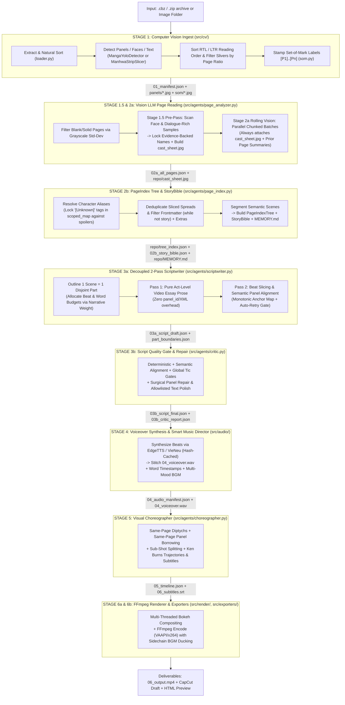

# Detailed Architecture Guide — Manga Recap Generator (`docs/ARCHITECTURE.md`)

> Comprehensive technical explanation of the system architecture—covering the big picture, each processing stage, data contracts, the philosophy behind avoiding magic numbers, and the Architecture Impact Checklist for code modifications.

---

## Table of Contents

1. [The Big Picture: What Does This System Do?](#1-the-big-picture-what-does-this-system-do)
2. [Why Numbers Still Exist & How the System Achieves True Generalization](#2-why-numbers-still-exist--how-the-system-achieves-true-generalization)
3. [6-Stage Pipeline Data Flow Diagram](#3-6-stage-pipeline-data-flow-diagram)
4. [Stage-by-Stage Technical Breakdown (Stage 1 → Stage 6)](#4-stage-by-stage-technical-breakdown-stage-1--stage-6)
   - [4.1. Stage 1 — Comic Ingestion & Panel Slicing (`src/cv/`)](#41-stage-1--comic-ingestion--panel-slicing-srccv)
   - [4.2. Stage 1.5 & 2a — Face Discovery & Page Reading (`src/agents/page_analyzer.py`)](#42-stage-15--2a--face-discovery--page-reading-srcagentspage_analyzerpy)
   - [4.3. Stage 2b — Junk Filtering, Anti-Spoiler & Story Indexing (`src/agents/page_index.py`)](#43-stage-2b--junk-filtering-anti-spoiler--story-indexing-srcagentspage_indexpy)
   - [4.4. Stage 3a — Decoupled 2-Pass Scriptwriter (`src/agents/scriptwriter.py`)](#44-stage-3a--decoupled-2-pass-scriptwriter-srcagentsscriptwriterpy)
   - [4.5. Stage 3b — Script Critic V3.7 (`src/agents/critic.py`)](#45-stage-3b--script-critic-v37-srcagentscriticpy)
   - [4.6. Stage 4 — Voiceover Synthesis, Music Dataset & Smart Music Director (`src/audio/`)](#46-stage-4--voiceover-synthesis-music-dataset--smart-music-director-srcaudio)
   - [4.7. Stage 5 — Visual Choreographer & Shot Pacing (`src/agents/choreographer.py`)](#47-stage-5--visual-choreographer--shot-pacing-srcagentschoreographerpy)
   - [4.8. Stage 6a & 6b — FFmpeg Rendering & Exporters (`src/render/`, `src/exporters/`)](#48-stage-6a--6b--ffmpeg-rendering--exporters-srcrender-srcexporters)
   - [4.9. Multi-Volume Series Continuity Engine (`src/series/`, `src/schemas/series.py`)](#49-multi-volume-series-continuity-engine-srcseries-srcschemasseriespy)
5. [Shared Infrastructure: LLM Client, Plugin Registry & Checkpointing](#5-shared-infrastructure-llm-client-plugin-registry--checkpointing)
6. [Architecture Impact Checklist (MANDATORY REFERENCE WHEN EDITING CODE)](#6-architecture-impact-checklist-mandatory-reference-when-editing-code)

---

## 1. The Big Picture: What Does This System Do?

Imagine a human editor producing a **Manga/Manhwa Recap & Review** video for YouTube:
1. Open the volume, skip the cover, blank pages, table of contents, and end-of-book afterwords.
2. Slice each panel on every page in proper reading order (right-to-left for Japanese Manga, top-to-bottom for Korean Manhwa).
3. Track main character faces consistently so names are never swapped.
4. Understand the plot from start to finish and divide the volume into sequential scenes.
5. Write a **natural Vietnamese spoken narration** (voiceover), pointing precisely to the panels on screen that match what is being narrated.
6. Record the voiceover, synchronize panels to spoken sentences, add camera pans (Ken Burns), burn subtitles, and mix background music that automatically ducks under speech.

**Manga Recap Generator** automates 100% of this workflow into a **6-Stage Pipeline**. Input is a `.cbz`/`.zip` archive (or image folder), and the final output is a complete `06_output.mp4` video.

### The 3 Hardest Problems the Architecture Must Solve
- **Problem 1 — Frame-to-Script Drift**: If the narrator describes page 40 while the screen still shows page 30 (or worse, spoils a future page not yet narrated), the viewer experiences jarring visual-audio desync.
- **Problem 2 — Content Duplication**: A 180–200 page volume is too long for an LLM to write a detailed script in a single call. Yet naive chunking into Parts causes the next Part to re-narrate the tail of the previous Part.
- **Problem 3 — Character Confusion & Identity Spoilers**: Black-and-white manga often has characters with similar hairstyles, or masked/unnamed figures ("person in the red cloak") whose true names are only revealed near the end. The system must neither confuse characters nor spoil their real names on page 1.

---

## 2. Why Numbers Still Exist & How the System Achieves True Generalization

When looking at a system processing **Images (Pixels) + Sound (Audio Waveforms) + Language (LLM)**, a natural question arises: *"Why do numbers still appear in the code? Does having numbers mean it isn't truly general?"*

The answer lies in strictly separating **3 tiers of numeric nature**:

### Tier 1: Structural Invariants & Logical Relations (0% numbers needed)
At the narrative logic and visual-audio sync layer, a sound architecture **never uses guessing numbers**, relying instead on **set relations and state machines**:
- **Frontmatter Filtering**: Never guess *"the first 6 pages are cover/TOC"* (`idx < 6` — WRONG). Instead use a **state machine `while not story`**: until the first real story page (multi-panel action or dialogue) is encountered, all covers/inserts/TOCs are skipped. Once the first story page hits, `story` flips to true and locks the frontmatter filter.
- **Zero-Duplication Partitioning (`1 Scene = 1 Part`)**: Never feed tail prose from Part $i-1$ into Part $i$. Each Part's page set is **strictly disjoint**: $Pages(Part_i) \cap Pages(Part_j) = \emptyset$.
- **Panel Borrowing & Diptych Locks (Choreographer Invariant)**:
  - Two panels may share a diptych screen only when `p1.page_id == p2.page_id` (same page).
  - When a long narration beat needs extra panels on that page, it may only borrow unused panels satisfying `cand.page_id in beat_pages`. This is an absolute set invariant with zero magic numbers.
- **Anti-Spoiler Identity Lock**: Never block by specific character names. Anonymous descriptors (`[Chưa rõ tên: ...]`, `"bí ẩn"`, `"người lạ"`) may only map locally at the exact page where they are explained (`scoped_map[(name, page_id)]`), never in the global dictionary (`global_map`).

### Tier 2: Physical Signal-to-Symbol Boundary (Pixels / Waveforms to Discrete Concepts)
A computer initially sees a comic page as millions of brightness values (`0` black to `255` white) and dimensions `width x height` pixels. Converting **continuous physical signals** into **discrete concepts** ("blank page", "double-page spread", "border sliver") requires geometric/statistical measurements:
- **How to keep physical measurements from becoming "Magic Numbers"?**
  1. **Never use absolute pixel thresholds**: A `100px` panel is tiny on a 4K scan (`3000px`) yet huge on a `500px` web image. Every geometric threshold must be **normalized by the page's own dimensions** (`ratio = panel_side / min(page_width, page_height)`).
  2. **Cross-page geometric invariants**: A double-page spread duplicated as 2 single pages exhibits the invariant: the spread is landscape (`width > height`), the 2 adjacent pages are portrait (`height > width`), and comparing the left/right halves of the spread against the 2 single pages on a proportional downscaled grid yields near-zero pixel error (MAE differing only by JPEG artifacts).
  3. **Dynamic script density scaling**: How many pages a single beat spans is never hardcoded to `3` or `4`, but computed from **actual narrative density** `avg_pages_per_beat = total_pages / total_beats`. A fast 3-minute recap (fewer beats) allows each beat to span more pages; a deep 15-minute recap (more beats) narrows each beat to 1–2 pages.

### Tier 3: User-Selected Product Parameters (`config.yaml`)
Values like `1280x720` resolution, `24 fps` frame rate, `48000 Hz` sample rate, `225 wpm` reading pace, and `target_duration_min: 11.0` are **product design inputs** centralized in `config.yaml` for user customization, never buried in algorithmic logic.

### Core Design Principle: "Lock Truth & Technique, Unlock Storytelling Craft" (Invariants vs. Affordances)
A common trap when upgrading AI systems is **replacing rigid mechanical heuristics (V1) with rigid creative formulas (V2)**: e.g., seeing that hit YouTube recaps often use a 30-second Cold Open, alternating sentence lengths, or witty commentary, and turning those surface habits into mandatory rules for every volume. Doing so reduces the LLM to a fill-in-the-blank template engine.

Thus, the architecture strictly separates two responsibility zones:
1. **Hard Invariants Zone (Truth & Engineering only)**: No fabricated names/events, no early spoilers, narration grounded strictly in displayed panels, zero duplication, zero leaked extras, clean audio/subtitles.
2. **Context-Driven Affordances Zone (Storytelling Craft)**:
   - Rather than *forcing* every volume into a single opening hook style, fixed scene page ranges, or per-beat word formulas, the system **unlocks a toolkit of options** (e.g., open *in medias res* if chapter 1 already starts mid-action, or *montage/premise* if the opening is slow; hold artistic spreads longer rather than slicing mechanically every few seconds).
   - **Macro/Distribution Critique**: The Critic flags global symptoms (such as uniform cadence across the entire volume or bunched end-of-act pages), without micromanaging individual beats/shots against a fixed arithmetic template.

---

## 3. 6-Stage Pipeline Data Flow Diagram

---

## 4. Stage-by-Stage Technical Breakdown (Stage 1 → Stage 6)

### 4.1. Stage 1 — Comic Ingestion & Panel Slicing (`src/cv/`)
- **Purpose**: Convert a raw `.cbz`/`.zip` archive or image folder into clean pages and cropped panels numbered in human reading order.
- **How it works**:
  1. `loader.py`: Extracts and sorts filenames using natural numeric sorting (`natural_sort_key`, ensuring `p2` precedes `p10`).
  2. `stage.py`: Inspects aspect ratios to select the detector automatically:
     - For long vertical **Manhwa/Webtoon** strips $\rightarrow$ runs `ManhwaStripSlicer` (`manhwa_slicer.py`) to locate horizontal whitespace gutters and slice panels, followed by a YOLO `face/body/text` post-pass.
     - For **Manga** pages $\rightarrow$ runs `MangaYoloDetector` (`manga_detector.py`) using ONNX YOLOv11 to detect 4 classes: **`frame`**, **`face`**, **`body`**, and **`text`**.
  3. **Page-Relative Noise Filtering & Inset Trimming**: Drops tiny border slivers normalized against `min(w, h)` or pure grayscale screentone fragments with no faces or text; trims excess white borders on inset pages while shifting `focal_points` coordinates in sync (`trim_white_border_with_offset`).
  4. **Reading-Order Sorting**: Uses **Recursive XY-Cut** to order panels accurately across L-shape / split-column layouts in `rtl` (Manga) or `ltr` (Comics).
  5. **Set-of-Mark Annotation (`som.py`)**: Draws `[P1]`, `[P2]`, ... tags directly onto the page image corners so the Stage 2a Vision LLM references exact panels without confusion.
- **Outputs**: `01_manifest.json`, cropped `panels/*.jpg`, and annotated `som/*_som.jpg`.

---

### 4.2. Stage 1.5 & 2a — Face Discovery & Page Reading (`src/agents/page_analyzer.py`)
- **Purpose**: Transcribe actions, emotions, and dialogue per panel in Vietnamese while maintaining consistent character identities from start to finish.
- **Why Stage 1.5 (Pre-Pass Cast Discovery) runs before page-by-page reading**:
  - Without a visual face reference sheet, when a character reappears 80 pages later without being named in a speech bubble, a Vision LLM easily confuses them with another character.
  - Stage 1.5 samples pages with the highest face + text density across the volume to discover the main cast. Every recorded character **must include an `evidence_quote` from the page**, preventing external series-memory hallucinations.
  - The system crops each character's sharpest face portrait and renders a labeled reference grid using Pillow UTF-8 at **`repo/cast_sheet.jpg`**.
- **How Stage 2a works**:
  1. **Pre-Vision Blank & Duplicate Spread Filtering**: `_is_blank_or_solid_page()` measures grayscale pixel std-dev to mark blank/solid inserts immediately (`0` tokens, preventing Vision hallucinations on blank sheets). `_detect_duplicate_spread_pages()` filters redundant single pages sliced from double-page spreads in CV before calling Vision.
  2. **Chunked Parallel Rolling Vision & Adaptive Batching**: Batches pages dynamically by panel density (`~16–18 panels/call`), always attaching `cast_sheet.jpg` alongside summaries of preceding pages (`RollingSceneState`) and a 4-character RAM **Visual Verify Code** stamp against dropped/shifted pages. Extracts `verbatim_quote_vi` and `visual_punch`.
- **Outputs**: `repo/seed_cast.json`, `repo/cast_sheet.jpg`, `02a_pages/*.json`, and `02a_all_pages.json`.

---

### 4.3. Stage 2b — Junk Filtering, Anti-Spoiler & Story Indexing (`src/agents/page_index.py`)
- **Purpose**: Clean the story page sequence, unify character aliases without leaking spoilers, and build the hierarchical scene index (`PageIndexTree`) plus character/plot bible (`StoryBible` & `MEMORY.md`).
- **3 Core Protections in Stage 2b**:
  1. **Scoped Anti-Spoiler Alias Resolution (`_resolve_character_aliases`)**:
     - Unifies nicknames and full names into `canonical_name` across `characters_present`, `page_summary`, `action_summary`, and `dialogue_summary`.
     - Anonymous descriptors (`[Chưa rõ tên: ...]`, `"bí ẩn"`, `"người lạ"`) are **strictly forbidden** from entering `global_map`, mapping only in `scoped_map` per page so mysteries stay intact until the actual reveal page (`first_named_page_id`).
  2. **Bidirectional Duplicate Spread Filtering (`_detect_duplicate_spread_pages`)**:
     - Detects both `[Spread, P1, P2]` and `[P1, P2, Spread]` archive layouts by splitting the landscape spread in half, downscaling proportionally to match the portrait pages, and measuring grayscale MAE; redundant singles are recorded in `skipped_pages`.
  3. **State-Machine Frontmatter & Appendix Filtering (`_filter_story_pages`)**:
     - Until the first true story page (`while not story`), covers, inner titles, TOCs, and dialogue-less 1-panel inserts are skipped.
     - Pages tagged `[PHỤ LỤC]` (bonus gag strips, translator notes, afterwords, copyright pages) are excluded from the main story stream.
- **Outputs**: Compressed `repo/notes/scene_*.md`, `repo/tree_index.json`, `02b_story_bible.json`, `repo/MEMORY.md`, and `repo/pronunciation.json`.

---

### 4.4. Stage 3a — Decoupled 2-Pass Scriptwriter (`src/agents/scriptwriter.py`)
- **Purpose**: Decouple literary prose quality from technical XML/`panel_id` formatting constraints, producing smooth Video Essay narration (`03a_script_draft.json`).
- **Decoupled 2-Pass Architecture ("Separate the Author from the Aligner")**:
  1. **`1 Scene = 1 Part` Partitioning & Water-Filling (`_allocate_part_budgets`)**: `OutlinePlannerAgent` creates semantic parts (`skim` / `steady` / `spotlight`), allocating word/beat budgets via Water-filling + Largest Remainder weighted by `narrative_weight` so climaxes are never starved.
  2. **Pass 1 — Pure Storyteller (`ProseWriterAgent`, `temperature=0.72`)**: Groups consecutive parts into **3–4 Acts** (`_group_parts_into_acts`), reads clean story summaries stripped of CV metadata (`_strip_cv_metadata_for_prose`, zero `panel_id` or `ar=...` clutter), writes cohesive Video Essay prose (`repo/script/prose_draft.md`), and respects `first_named_page_id` anti-spoiler gates.
  3. **Pass 2 — Beat Slicer & Semantic Panel Aligner (`PanelAlignerAgent`, `temperature=0.15`, shared `src/agents/alignment.py`)**: Before calling the LLM, `build_alignment_anchors()` uses IDF unigrams/bigrams + Quote Pinning + Monotonic DP to generate a **Page Anchor Map** for each sentence. Pass 2 receives the verbatim Pass 1 prose + Page Anchor Map + original panel list, **slicing `<beat>` tags and binding `panel_ids` monotonically to exact events/quotes** without rewriting the prose. Every call is guarded by an **Auto-Retry Gate (`verify_beats_alignment`)** catching `quote_mismatch` and `visual_desync`, alongside `_prose_preservation_ratio >= 0.78`, `pin_missing_quote_panels`, and `_sanitize_part_beats`.
- **Outputs**: `repo/OUTLINE.json`, `repo/script/acts/act_*.json`, `repo/script/prose_draft.md`, `repo/script/parts/part_*.json`, `repo/script/part_boundaries.json`, and `03a_script_draft.json`.

---

### 4.5. Stage 3b — Script Critic V3.7 (`src/agents/critic.py`)
- **Purpose**: Four-tier verification ensuring factual accuracy, **strict visual-audio alignment (detecting + repairing `panel_ids`)**, zero N-gram/tic repetition, and preservation of Pass 1's Video Essay voice.
- **4 Tiers of `CriticAgent` V3.7**:
  1. **Tier 1 — Deterministic Gate, Monotonicity-Aware Semantic Alignment Gate & Global Tic Scanner (Pure Python)**: Verifies `grounding`, Part boundaries, dynamic beat page span, monotonic progression, `coverage_gap`, **content-level & quote-level alignment via `verify_beats_alignment` (`src/agents/alignment.py`)**, `spoiler_name` (via `first_named_page_id`), N-gram `duplication`, AI clichés, `budget` (`> +30%`), plus 3 statistical scanners (**`opener_repeat`**, **`tic_repeat`** outside quoted dialogue, **`seam_echo`**) and macro colon `:` / staccato sentence density checks.
  2. **Tier 2 & 3a — Surgical Panel Repair (`CriticPanelRepairer` + Deterministic Safety-Net)**: Repairs surviving `panel_sync` or `coverage_gap` issues within each Part's allowlist (guarded by a **Rollback Guard** requiring fewer errors and zero page regressions, plus deterministic safety-net `repair_part_panel_alignment_deterministic`) while leaving `narration_vi` 100% untouched.
  3. **Tier 2 & 3b — Read-Only Semantic Auditor (`CriticSemanticAuditor`) & Allowlisted Text Repairer (`CriticSeamPolisher`)**: Reads the full script in 1 context to flag up to 8 paraphrased repetition or awkward transition beats; edits only **allowlisted `editable_ids`** backed by `<grounded_facts>` and a **Per-Beat Rollback Guard**.
  4. **Tier 4 — Re-Validate & Pronunciation Prep**: Re-scores `CriticReport` and populates `tts_text` from `pronunciation_map`.
- **Outputs**: `03b_script_final.json` and `03b_critic_report.json`.

---

### 4.6. Stage 4 — Voiceover Synthesis, Music Dataset & Smart Music Director (`src/audio/`)
- **Purpose**: Synthesize accurate Vietnamese voiceover from `tts_text` and mix genre-matched background music and real SFX.
- **How it works**:
  1. **TTS Cache & Word Synchronization (`stage.py`, `base.py`)**: Hashes each beat with `beat_cache_key` (including text, voice, backend, and `rate`), applies anti-aliased Fourier resampling, and stitches `04_voiceover.wav` (48kHz PCM) with word-level timestamps in `04_audio_manifest.json`.
  2. **Automated Music & SFX Dataset (`music_library.py`, CLI `manga-recap music fetch|index|list`)**: Manages tracks in `assets/music_library/catalog.json`. Supports downloading a CC-BY 4.0 starter pack (Incompetech) across all 7 `mood`s or indexing custom MP3/WAV folders via pure NumPy DSP analysis (**LUFS**, **BPM**, **brightness**, **energy**, and **`active_start_sec`** to skip silent intros).
  3. **Smart Music Director (`music_director.py`, `bgm_generator.py`)**: Reads `StoryBible.tone_summary` to pick a **genre music palette**, merges adjacent beats into **Music Cues >= 28s** (preventing track jumping every 5s), normalizes every track to **`-16 LUFS`**, prevents back-to-back track repeats, applies **2.5s equal-power crossfades**, inserts real SFX with a **6-second cooldown**, saves `audio/04b_music_cues.json`, and exports YouTube-ready CC-BY credits to `exports/music_credits.txt` (falling back seamlessly to the 4-bar synth if no catalog exists).

---

### 4.7. Stage 5 — Visual Choreographer & Shot Pacing (`src/agents/choreographer.py`)
- **Purpose**: Combine the validated script (`03b_script_final.json`) with actual audio timing (`04_audio_manifest.json`) to schedule exact panel shots, camera trajectories, and subtitle cues.
- **4 Core Choreography Rules Preserving Visual-Audio Grounding**:
  1. **Cross-Beat Boundary Dedup (`dedup_cross`)**: If a new beat starts with the exact panel that closed the previous beat, drop the duplicate so visuals always advance.
  2. **Same-Page Panel Borrowing (`cand.page_id in beat_pages`)**: When a long narration beat has few assigned panels, borrow unused panels strictly from the pages already belonging to that beat—never from future beats.
  3. **Same-Page Diptych Pairing (`p1.page_id == p2.page_id`)**: Pair consecutive narrow vertical panels on the **same page** side-by-side in 16:9 according to `reading_order` (right-to-left for Manga, left-to-right for Comics).
  4. **Word-Timestamp / Proportional Shot Pacing & Sub-Shot Splitting**: Uses real `WordTimestamp` cues when available (falling back to character-length proportions) and splits detail-rich long shots into 2 camera moves (*Wide → Focus Face*).
- **Outputs**: `05_timeline.json` and `06_subtitles.srt`.

---

### 4.8. Stage 6a & 6b — FFmpeg Rendering & Exporters (`src/render/`, `src/exporters/`)
- **Purpose**: Render `05_timeline.json` and `04_voiceover.wav` into the final `.mp4` video and companion project exports.
- **Quality & Performance Optimizations**:
  1. **Inset White-Border Trimming (`_trim_excess_white_border`)**: Strips overwhelming white margins on single-vignette inset pages so artwork fills the frame crisply.
  2. **Bokeh Backgrounds & Pre-Multiplied Alpha Subtitles (`compositor.py`, `subtitles.py`)**: Renders framed panels with soft shadows over bokeh-blurred backdrops and caches word-wrapped RGBA subtitle overlays across multi-threaded workers (`ThreadPoolExecutor`).
  3. **Hardware Encoding & Sidechain BGM Ducking**: Streams raw frames via `stdin pipe` into FFmpeg (`h264_vaapi` if available, else `libx264`). `sidechaincompress` automatically ducks BGM under narration and swells it during pauses.

---

### 4.9. Multi-Volume Series Continuity Engine (`src/series/`, `src/schemas/series.py`)
- **Purpose**: Scale the pipeline from single volumes to 24+ volume series while preserving 100% character faces, names/terminology/pronouns, inter-volume emotional continuity, music palette identity, and both **standalone episodes (`episodic`)** and **compiled Arc/Full-Series movies (`seamless` + `compile`)**.
- **4 Core Layers ($O(1)$ bounded context regardless of volume count)**:
  1. **Portrait Vault & Dynamic Active Cast (`src/series/memory.py`)**: Persists canonical 188×192 portraits at `series/<id>/portraits/<char_id>.jpg`, dynamically selects up to 16 active characters for Vol $k$ via `select_active_cast_for_volume()` (new cast + previous volume's ending handoff + recent appearances; retiring long-absent/deceased cast), reads directly from `portrait_path` instead of stale `panel_id`s, and unlocks `first_named_page_id` via `get_previously_revealed_names()` for characters revealed in Vol $< k$.
  2. **3-Tier Bounded Memory (`Hot / Warm / Cold`) + Human-Editable `glossary.yaml`**:
     - *Hot*: `VolumeHandoff` (ending summary, open cliffhangers, last 2–3 beats of Vol $k-1$).
     - *Warm*: Up to 12 `active_plot_threads` + locked `terminology` & `pronoun_pairs` in `series/<id>/glossary.yaml` (manual user edits always take immediate precedence and are never overwritten).
     - *Cold*: Compressed 3–5 sentence `VolumeLedgerEntry` per volume; retrieves up to 3 relevant past volumes by character/keyword overlap for callbacks.
  3. **Continuity-Aware Scriptwriter, Critic & Music Identity**: Stage 3a adapts openings/closings by mode (`episodic` bridges in 1–2 sentences without re-introducing returning cast; `seamless` omits inter-volume greetings/outros). Stage 3b (`CriticAgent`) enforces `series_continuity` (glossary compliance, no verbatim repetition of previous ending, no greeting leaks in `seamless` mode). `Smart Music Director` locks `music_genre_prefs` from Vol 1 and avoids reusing the prior volume's closing track as the next opener.
  4. **Batch Orchestrator & Arc/Full-Series Compiler (`orchestrator.py`, `compiler.py`, CLI `manga-recap series`)**: Discovers and natural-sorts Vol 1..N, runs checkpointed sequential volumes (resumable from any volume), reloads `glossary.yaml` between volumes, and compiles multi-volume MP4s (fast stream-copy or re-encode) with cumulatively shifted `.srt` files, YouTube Chapters (`00:00 Tập 1: ...`), and deduplicated `music_credits.txt`.

---

## 5. Shared Infrastructure: LLM Client, Plugin Registry & Checkpointing

- **`src/llm/client.py` (`LLMClient`)**:
  - Supports separate providers for Text LLM (`provider`, passed via `extra_body={"provider": ...}`) and Vision LLM (`vision_provider: null` or dedicated).
  - Includes a **Circuit Breaker**: if `default_model` fails consecutively past `max_retries` (threshold: 2 errors), the client trips and routes remaining session calls to `fallback_model` (e.g., `gpt-6-luna`) so pipelines do not crash mid-run.
  - Enforces truncation detection (`finish_reason == "length"`) and strict Pydantic schema validation for JSON/XML responses.
- **`src/core/registry.py` (`PluginRegistry`)**:
  - CV Detectors (`DETECTOR_REGISTRY`), TTS (`TTS_REGISTRY`), Renderers (`RENDERER_REGISTRY`), and Exporters (`EXPORTER_REGISTRY`) all register declaratively via `@REGISTRY.register("plugin_name")`.

---

## 6. Architecture Impact Checklist (MANDATORY REFERENCE WHEN EDITING CODE)

> 🔴 **MANDATORY RULE**: Before and after modifying the architecture, algorithms, or data schemas of any Stage, you **MUST** consult this table to verify affected invariants and update both `docs/ARCHITECTURE.md` and `AGENTS.md`.

| If you modify this component... | You MUST check these invariants & downstream files | Tests & checkpoints to re-run |
|---|---|---|
| **Stage 1: CV Ingest** (`src/cv/*`, `src/schemas/ingestion.py`) | 1. Is panel noise filtering still normalized by `min(w, h)` rather than hardcoded pixel thresholds? 2. Does `panel_id` ordering (`_P1.._Pn`) match the labels stamped on `som/*_som.jpg`? 3. Do `JobManifest` schema changes affect `PageAnalyzerAgent`, `PageIndexBuilder`, `CriticAgent`, or `ChoreographerAgent`? | - Run `uv run pytest tests/test_cv.py tests/test_schemas_and_json.py` - Clear `01_manifest.json`, `panels/`, `som/` if panel slicing changes. |
| **Stage 1.5 & 2a: Vision Analyzer** (`src/agents/page_analyzer.py`, `src/schemas/analysis.py`) | 1. Are blank/solid pages and duplicate spreads blocked before calling the Vision LLM? 2. Does the 4-char RAM `Visual Verify Code` banner validate `visual_verify_code` and retry `analyze_page` up to 2× on dropped/shifted images? 3. Does XML `<pages>` parsing safely preserve Vietnamese quotes and speech bubbles? | - Run `uv run pytest tests/test_page_index_and_agents.py` - Verify `test_no_series_specific_overfitting_in_codebase`. |
| **Stage 2b: PageIndex & StoryBible** (`src/agents/page_index.py`) | 1. **Anti-Spoiler**: Does `_compute_character_reveal_pages()` compute `first_named_page_id` from actual spoken dialogue while ignoring `<Speaker> nói:` prefixes? Are temporary labels blocked from `global_map`? 2. **Filtering & TTS**: Is bidirectional spread filtering active and `pronunciation_map` left empty by default (loaded only from `repo/pronunciation.json` if present)? | - Run `uv run pytest tests/test_page_index_and_agents.py` - Clear `02b_story_bible.json` and `repo/tree_index.json` onward when re-running jobs. |
| **Stage 3a: Scriptwriter** (`src/agents/scriptwriter.py`, `src/agents/alignment.py`, `configs/personas.yaml`) | 1. **Zero Duplication**: Do `OutlinePart`s preserve disjoint `1 Scene = 1 Part` partitioning and XML `<part_script>` output? 2. **Visual-Audio Sync & Anti-Drift**: Does Pass 2 receive the Page Anchor Map (`build_alignment_anchors`), run the `verify_beats_alignment` Auto-Retry Gate and `pin_missing_quote_panels`? Does `_sanitize_part_beats()` avoid stripping valid dialogue panels? 3. **Anti-Spoiler**: Do prompts forbid naming characters before `first_named_page_id`? | - Run `uv run pytest tests/test_page_index_and_agents.py` - Clear `repo/script/parts/`, `03*..06*` (or `repo/OUTLINE.json` & `acts/`) when regenerating scripts. |
| **Stage 3b: CriticAgent** (`src/agents/critic.py`, `src/agents/alignment.py`, `src/schemas/script.py`) | 1. Does Critic catch `quote_mismatch` / `visual_desync` via monotonicity-aware `verify_beats_alignment` and repair `panel_ids` via `CriticPanelRepairer` (+ Rollback Guard + `repair_part_panel_alignment_deterministic`) without altering narration text? 2. Are N-gram duplication (`_content_ngrams`), `spoiler_name`, `opener_repeat` / `tic_repeat` / `seam_echo`, backward page jumps (`cur_min < prev_page_pos`), and Per-Beat Rollback Guard functioning properly? | - Run `uv run pytest tests/test_page_index_and_agents.py` - Check `03b_critic_report.json` for `0` `duplication`, `spoiler_name`, and `panel_sync` errors. |
| **Stage 4 & 5: Audio & Choreographer** (`src/audio/*`, `src/agents/choreographer.py`, `src/schemas/timeline.py`) | 1. **Same-Page Visual Invariants**: Does `_is_diptych_candidate()` enforce `p1.page_id == p2.page_id`? Does panel borrowing enforce `cand.page_id in beat_pages` and `cand.page_id not in skipped_pages`? 2. Are shot durations (`slot_durations`) aligned to word timestamps or proportional sentence lengths? | - Run `uv run pytest tests/test_audio.py tests/test_renderer_and_exporters.py` - Clear `05_timeline.json`, `06*` after editing Choreographer. |
| **Stage 6: Renderer & Exporters** (`src/render/*`, `src/exporters/*`) | 1. Does `_trim_excess_white_border()` handle heavily padded inset pages? 2. Does `compositor.py` draw diptychs in proper `reading_order` (right-first for RTL, left-first for LTR)? 3. Does FFmpeg export Stereo AAC 48kHz with `sidechaincompress` BGM ducking and honor `series_music_context.json`? | - Run `uv run pytest tests/test_renderer_and_exporters.py` |
| **Multi-Volume Series Engine** (`src/series/*`, `src/schemas/series.py`) | 1. Does `SeedCharacter.portrait_path` prioritize `series/<id>/portraits/` when building `cast_sheet.jpg` and clear stale `best_panel_id` values? 2. Are characters revealed in Vol $< k$ unlocked (`first_named_page_id=""`) while new mysterious characters in Vol $k$ stay spoiler-locked? 3. Do manual edits in `glossary.yaml` take precedence and survive `update_after_volume()` untouched? | - Run `uv run pytest tests/test_series_continuity.py tests/test_page_index_and_agents.py` - Verify `test_no_series_specific_overfitting_in_codebase`. |
