# Comprehensive Architecture Review — Manga Recap Generator

> **Audit Scope**: Full 6-Stage Pipeline (`src/`, `config.yaml`, `configs/personas.yaml`), empirical data from `jobs/pandora_hearts_vol1` (`telemetry.json`, `OUTLINE.json`, `03b_script_final.json`, `05_timeline.json`), and direct benchmarking against 3 real-world Vietnamese YouTube recap scripts (**Phê Phim**, **Anime Rewind**, **AL Anime**).
> **Status**: **V2 FULLY IMPLEMENTED** (17 findings resolved + Group A & B token optimizations + Adaptive Panel Batching + 5 script-quality upgrades + `default_model: gpt-6.2-sol`).

---

## Table of Contents

1. [Overall Architecture Assessment (Strengths vs. Quality Ceiling)](#1-overall-architecture-assessment)
2. [Anatomy of 3 Real YouTube Scripts & Gaps vs. Current Script](#2-anatomy-of-3-real-youtube-scripts--gaps-vs-current-script)
3. [17 Architectural Gaps, Hidden Bugs & Practical Bottlenecks (With Code Evidence)](#3-17-architectural-gaps-hidden-bugs--practical-bottlenecks)
4. [What Should Be REMOVED (Dead Code, Dead Config & Unnecessary Complexity)](#4-what-should-be-removed)
5. [What Should Be ADDED & UPGRADED (Proposed V2 Architecture)](#5-what-should-be-added--upgraded)
6. [7 Strategic Challenge Questions & Answers](#6-7-strategic-challenge-questions--answers)
7. [Prioritized Roadmap (P0 / P1 / P2)](#7-prioritized-roadmap-p0--p1--p2)
8. [Token Analysis for N Pages, Optimization Strategy & Quality Trade-Offs](#8-token-analysis-for-n-pages-optimization-strategy--quality-trade-offs)

---

## 1. Overall Architecture Assessment

### Architectural Strengths (Keep as Foundation)
- **Clear Stage-by-Stage Checkpointing** (`01_manifest` → `02a_pages` → `02b_story_bible` + `repo/` → `03a/03b` → `04_audio` → `05_timeline` → `06_output.mp4`): Allows re-running downstream stages locally without re-incurring Vision LLM costs.
- **Solid Grounding & Anti-Spoiler Chain**: Pre-Pass `cast_sheet.jpg` with `evidence_quote`, anonymous labels locked in `scoped_map`, blank page filtering via grayscale std-dev, duplicate spread removal via MAE, disjoint `1 Scene = 1 Part` partitioning, and same-page diptych/borrowing locks in the choreographer.
- **Clean Modularity** via `PluginRegistry` (`DETECTOR_REGISTRY`, `TTS_REGISTRY`, `RENDERER_REGISTRY`, `EXPORTER_REGISTRY`) and automated anti-overfitting tests.

### What Was the Initial "Quality Ceiling"?
Based on empirical runs of `jobs/pandora_hearts_vol1`:
- **Technical Synchronization**: The baseline reached **Clean & Accurate** (`0` Critic errors, `0` N-gram duplicates, `0` backward page jumps, `0` leaked extras).
- **YouTube Production Polish**: Output still felt like an **"accurate plot summary read by AI voice"** rather than a **"million-view recap/review video"** across 4 dimensions: **(1) Storytelling Structure & Emotional Pacing**, **(2) Dynamic Audio (proper-noun pronunciation, mood-matched BGM, SFX, word-level subtitle sync)**, **(3) TTS Throughput**, and **(4) True Generalization across Manhwa, LTR Comics, 9:16 Vertical Video, and Multi-Volume Series**.

---

## 2. Anatomy of 3 Real YouTube Scripts & Gaps vs. Current Script

Full Vietnamese transcripts of all 3 benchmark videos were extracted and analyzed:

| Video | Channel | Genre / Length | Signature Scripting Traits |
|---|---|---|---|
| `5SBWbgbGlFI` (*All About Cyberpunk: Edgerunners*) | **Phê Phim** | Essay / Review-Recap (~8,456 words, ~39 min) | **54s Thematic Hook** posing a central dramatic question before entering the plot (`&t=54s` transitions cleanly from Framing Hook to *"Everything starts with David..."*). Blends narration with sharp psychological/social commentary; slows zoom during tragic/climactic scenes; closes with a Thematic Payoff echoing the opener. |
| `Zo--ONZTjws` (*Full JoJo Part 7: Steel Ball Run Recap*) | **Anime Rewind** | **Pure Manga Recap** (~36,589 words, ~170 min) | Opens with author context + value promise + spoiler warning. Coins **memorable nicknames** (*"gold-tooth guy"*, *"sugar kid"*, *"sand man"*), explains power mechanics (*Spin / Golden Ratio / Silent Way*) clearly with bridges like *"in other words..."*; sprinkles crisp jokes; executes smooth POV transitions (*"Meanwhile..."*, *"Back to Johnny..."*). |
| `vKMc6AToVJE` (*Overlord S1–S4 Compilation*) | **AL Anime / AL Tổng Hợp** | Rapid Anime/Manga Recap (~34,591 words, ~161 min) | Conversational friend-like narration with **4th-wall breaks** and candid personal reactions; closes with personal commentary + viewer discussion prompts. |

### 5 Core Gaps Compared to the Baseline Script (`03b_script_final.json`)

| Comparison Axis | Million-View YouTube Channels | Baseline Pipeline (`pandora_hearts_vol1`) | Architectural Root Cause |
|---|---|---|---|
| **1. Opening (0:00–0:45)** | Always opens with a **Cold Open / Framing Hook** setting world stakes + **Central Dramatic Question** to retain viewers past the first 30 seconds. | Jumped straight into summarizing page 5 (`b001`). The entire `part_01` (7 beats ≈ 2 min) was tagged `hook`. | Stage 3a lacked an **Intro Hook Montage** option (selecting 4–6 striking panels + 2–3 framing sentences). |
| **2. Commentary & Emotion Layer** | Every 3–5 plot sentences includes **1 insight / emotional beat / mechanic explanation / witty aside** giving the script a human voice. | **~98% pure event log** (*A does X → B does Y → C happens*). Plot-accurate but devoid of narrator perspective. | Prompts overly restricted beats to "describe only actions in 2–4 panels" without allowing **Commentary / Lore Explain** anchored to the scene. |
| **3. Dynamic Pacing** | Setup scenes compress rapidly (20 pages = 2 sentences); climaxes/tragedies **breathe and slow down**. | **100% Mechanical Even Split**: `part_01..part_08` each received `7 beats / 241 words` regardless of comedic banter vs. B-Rabbit climax! Every beat averaged `33–67 words` (**0 short beats under 33 words**). | `page_index.py` sliced fixed 20-page scenes; `scriptwriter.py` allocated words/beats linearly by page count with no **Narrative Weight**. |
| **4. POV Signposting** | Location/character/flashback shifts always use natural spatial bridges (*"Elsewhere..."*, *"Back to..."*). | Banned cliché announcer transitions without teaching natural POV/Flashback cues. | Lacked `scene_transition_type` classification (`continuous / flashback / pov_switch / time_skip`) from Stage 2b. |
| **5. Outro & Retention Payoff** | Closes with a **Thematic Wrap-up** + **Teaser / Discussion Prompt** for the next volume. | Cut off abruptly on the final page summary (`b060`). | Lacked an `outro_wrap` beat summarizing themes and teasing the continuation. |

---

## 3. 17 Architectural Gaps, Hidden Bugs & Practical Bottlenecks

All 17 issues below were **verified directly from source code and empirical artifacts**, ranked by impact:

### Group A — Critical / High Architectural & Logic Issues Impacting Video Quality

#### 1. `mood` Contract Mismatch Between Stage 3a & Stage 5 → Camera & Transition Effects Mostly Disabled
- **Evidence**:
  - [script.py](file:///home/daominhwysi/project/manga_recap_generator/src/schemas/script.py#L13) defined `mood: str = "tense"` (free-form string rather than `Literal`).
  - In `03b_script_final.json`, the LLM invented **33 distinct mood strings**: `terrifying`, `ominous`, `violent`, `shocked`, `chaotic`, `intense`, `desperate`, etc.
  - Meanwhile [choreographer.py](file:///home/daominhwysi/project/manga_recap_generator/src/agents/choreographer.py#L274-L294) only matched hardcoded strings: `("action", "explosive")` for `shake_impact` and `("action", "shocking", "explosive", "horrific")` for `flash_white`.
- **Empirical Impact**: Across 234 shots, there were **`0` `shake_impact` shots** and only **`1` `flash_white`** despite numerous combat/execution scenes.

#### 2. Mechanical `20 pages/scene` Slicing Breaks Scene Continuity & Inflates Duration (+29%)
- **Evidence**:
  - [page_index.py](file:///home/daominhwysi/project/manga_recap_generator/src/agents/page_index.py#L517) split scenes with `range(0, len(ch_pages), self.pages_per_scene)` (cutting blindly mid-fight or mid-dialogue). In `OUTLINE.json`, `part_04` cut across the B-Rabbit battle at `p092/p093`, and `part_06` split the Mad Baby battle at `p134/p135`.
  - [scriptwriter.py](file:///home/daominhwysi/project/manga_recap_generator/src/agents/scriptwriter.py#L100-L116) scaled `target_words` and `target_beats` linearly by page count, and LLM overruns (`2,695` actual words vs. `2,025` configured for `9.0 min`) pushed runtime to **`11.6 min` (+29%)**.
  - Semantic `section` labels were misassigned: **18/60 beats (30% of the video)** were labeled `cliffhanger`.

#### 3. Stage 3b `CriticAgent` Was a "Paper Tiger" (Advisory-Only, Never Failed, No Auto-Repair)
- **Evidence**:
  - [critic.py](file:///home/daominhwysi/project/manga_recap_generator/src/agents/critic.py#L217-L326): Every issue had `severity="warning"` while `passed = all(i.severity != "error" for i in issues)` → **`passed` was `True` 100% of the time!**
  - In [config.yaml](file:///home/daominhwysi/project/manga_recap_generator/config.yaml#L43), `polish_seams: false` meant clichés, backward page jumps, budget overruns, and N-gram repeats were logged and passed straight to TTS.
  - Even with `polish_seams: true`, [critic.py](file:///home/daominhwysi/project/manga_recap_generator/src/agents/critic.py#L107-L110) omitted neighboring beats for context and did not re-score `report.issues` after polishing.

#### 4. Stage 4 TTS Was the Biggest Runtime Bottleneck (56% of Runtime) + Resampling & Proper-Noun Bugs
- **Evidence**:
  - `telemetry.json`: Total runtime `1,360s` (`22.6 min`), with Stage 4 (`vieneu`) consuming **`766.3s` (`12.8 min` = 56.3% of total time)** via sequential CPU calls.
  - [base.py](file:///home/daominhwysi/project/manga_recap_generator/src/audio/base.py#L38-L42): Resampling `24kHz → 48kHz` used pure **`np.interp` linear interpolation** with no anti-aliasing low-pass filter → high-frequency metallic imaging artifacts.
  - [base.py](file:///home/daominhwysi/project/manga_recap_generator/src/audio/base.py#L19-L21): `beat_cache_key` omitted `rate` → changing Edge-TTS speed hit stale cache.
  - [vieneu_tts.py](file:///home/daominhwysi/project/manga_recap_generator/src/audio/vieneu_tts.py#L18): Docstring promised *"graceful Edge-TTS fallback"* with no fallback implementation.
  - **Missing TTS Pronunciation Layer**: Foreign proper nouns (`Vessalius`, `Baskerville`, `Abyss`, `Chain`, `B-Rabbit`, `Rainsworth`) passed verbatim to Vietnamese TTS caused mispronunciations.

#### 5. Linear Character-Ratio Subtitle & Shot Timing (No Word-Level Sync)
- **Evidence**:
  - [choreographer.py](file:///home/daominhwysi/project/manga_recap_generator/src/agents/choreographer.py#L130-L151) and [choreographer.py](file:///home/daominhwysi/project/manga_recap_generator/src/agents/choreographer.py#L222-L241) divided subtitle and shot timings purely by `len(chunk) / total_chars`.
  - Real TTS pauses longer at `.`, `?`, `"..."` and varies speaking cadence → causing `300–800ms` subtitle/panel drift on long beats.
  - Some shots froze for **`7,262 ms` (`7.26s`)** despite `max_shot_duration_ms = 3500` because the Choreographer could not split 1 large panel into 2 camera beats (*Wide → Focus Face*).

#### 6. Monotonous Single-Loop BGM & Zero SFX Layer
- **Evidence**:
  - [timeline.py](file:///home/daominhwysi/project/manga_recap_generator/src/schemas/timeline.py#L59) held a single `bgm_path` for the entire video; [bgm_generator.py](file:///home/daominhwysi/project/manga_recap_generator/src/audio/bgm_generator.py#L11-L99) synthesized a single dark D-minor sine loop playing nonstop for 11+ minutes—even during comedic scenes!
  - Completely lacked an **SFX layer** (scene whooshes, impact hits for `shake_impact`, flashes/stings for twists).

---

### Group B — Generalization Gaps

#### 7. Manhwa / Webtoon Was "Blind" to Focal Points & Used Hardcoded Pixels
- **Evidence**: [manhwa_slicer.py](file:///home/daominhwysi/project/manga_recap_generator/src/cv/manhwa_slicer.py#L20-L92):
  - Never ran YOLO `face` / `body` / `text` detection after slicing → `focal_points = []` for 100% of panels!
  - Cascading failure: Stage 1.5 `_select_prepass_pages` scored `faces * 3.0 + texts * 2.2` → **every Manhwa page scored 0**! Stage 2b tagged all panels `[bg-only]`! Stage 5 `focus_face` never triggered!
  - Hardcoded `min_gutter_px=18` and `min_panel_height=80` were absolute pixels rather than relative to image width.

#### 8. Western LTR Comics & Manga L-Shape Layouts Mishandled
- **Evidence**:
  - [compositor.py](file:///home/daominhwysi/project/manga_recap_generator/src/render/compositor.py#L174-L176) always laid out diptychs in RTL order (`fg2` left, `fg1` right), ignoring `manifest.reading_order`.
  - [choreographer.py](file:///home/daominhwysi/project/manga_recap_generator/src/agents/choreographer.py#L265-L268) always used `pan_left` for wide panels regardless of RTL/LTR.
  - [manga_detector.py](file:///home/daominhwysi/project/manga_recap_generator/src/cv/manga_detector.py#L44-L73): `sort_panels_reading_order` only grouped rows along Y (`overlap / min_h > 0.35`), misordering common **L-shape / 2-column split** Manga layouts (which require **Recursive XY-Cut**).

#### 9. Vertical `9:16` Video Mode (Shorts / TikTok / Reels) Broken
- **Evidence**:
  - `render.aspect_ratio` in [config.yaml](file:///home/daominhwysi/project/manga_recap_generator/config.yaml#L64) was **unread by any code**.
  - [subtitles.py](file:///home/daominhwysi/project/manga_recap_generator/src/render/subtitles.py#L51-L90): `_render_subtitle_patch` drew text on a **single horizontal line** with no word-wrapping, clipping long Vietnamese subtitles on `720px` vertical video.

---

### Group C — Subtle Cross-Stage Bugs

#### 10. `AliasResolverAgent` Normalized `characters_present` Only, Leaving `action_summary` & `page_summary` Untouched
- **Evidence**: [page_index.py](file:///home/daominhwysi/project/manga_recap_generator/src/agents/page_index.py#L454-L466) normalized `pnl.characters_present` only, while `ScriptwriterAgent` primarily read `page_summary`, `action_summary`, and `dialogue_summary`, allowing variant/inconsistent names to leak into Stage 3a.

#### 11. `cast_sheet.jpg` Garbled Vietnamese Fonts (`???`) & `StoryBible` Ignored `seed_cast.json`
- **Evidence**:
  - [page_analyzer.py](file:///home/daominhwysi/project/manga_recap_generator/src/agents/page_analyzer.py#L216-L225): Used `cv2.putText(..., FONT_HERSHEY_SIMPLEX)`, which is ASCII-only and turned Vietnamese names like *"Bà Kate"* or *"Tiểu thư"* into `B? Kate`!
  - [page_index.py](file:///home/daominhwysi/project/manga_recap_generator/src/agents/page_index.py#L644-L658): `StoryBibleAgent` only received `tree.compact_outline_view()`, discarding `seed_cast.json` (which held rich appearance notes and `evidence_quote` proofs).

#### 12. `focus_face` Coordinate Drift When `_trim_excess_white_border` Cropped in Stage 6a
- **Evidence**:
  - Stage 5 ([choreographer.py](file:///home/daominhwysi/project/manga_recap_generator/src/agents/choreographer.py#L270)) computed `focus_x, focus_y` on the **untrimmed** panel image.
  - Stage 6a ([ffmpeg_renderer.py](file:///home/daominhwysi/project/manga_recap_generator/src/render/ffmpeg_renderer.py#L307)) later trimmed white margins at render time, shifting facial coordinates off-center on asymmetric inset pages.

#### 13. Duplicate Spread Detection Only Checked `[Spread, P1, P2]` Order
- **Evidence**: [page_index.py](file:///home/daominhwysi/project/manga_recap_generator/src/agents/page_index.py#L99-L104) only checked `idx+1, idx+2` after a landscape spread, missing CBZ archives ordered `[P1, P2, Spread]`.

#### 14. Missing Cross-Volume Continuity & Stage 2b Per-Scene Caching
- Multi-volume series lacked `--prev-job` / `--prev-cast` / persistent Series Memory to lock terminology and faces across volumes, and `PageIndexSceneSummarizer` lacked per-scene caching.

#### 15. Skeleton Exporters (CapCut & HTML Preview)
- [capcut_draft.py](file:///home/daominhwysi/project/manga_recap_generator/src/exporters/capcut_draft.py#L26-L79) omitted `secondary_panel_path` (dropping all diptychs), BGM tracks, subtitle tracks, and zoom/pan keyframes.
- [preview_html.py](file:///home/daominhwysi/project/manga_recap_generator/src/render/preview_html.py#L11-L41) printed a text-only table without `` panel thumbnails or `<audio>` playback controls.

#### 16. `md_body[:24000]` Truncation Bug Dropped the Final 2–3 Pages of 8/9 Scenes
- **Evidence**:
  - [page_index.py](file:///home/daominhwysi/project/manga_recap_generator/src/agents/page_index.py#L574): `PageIndexSceneSummarizer` truncated `md_body[:24000]`.
  - In `jobs/pandora_hearts_vol1/repo/notes/`, `scene_001.md..scene_008.md` measured **`24,356` to `28,664` chars** $\Rightarrow$ **8/9 scenes lost `356–4,664` chars (2–3 trailing pages each)** when generating `Tree Index`.

#### 17. $O(N^2)$ Token Waste in Stage 3a & Redundant Duplicate Spread Vision Calls in Stage 2a
- **Evidence**:
  - [telemetry.json](file:///home/daominhwysi/project/manga_recap_generator/jobs/pandora_hearts_vol1/telemetry.json#L178-L248): `ScriptwriterAgent` consumed **`213,542 / 306,216` tokens (`69.7%` of Stage 2b+3a text tokens)**.
  - [scriptwriter.py](file:///home/daominhwysi/project/manga_recap_generator/src/agents/scriptwriter.py#L212-L236) re-injected entire previous scene markdowns (~7,090 tok/part) as `callback_texts` and repeated the full `compact_outline_view()` and `MEMORY.md` in every Part → **$O(N^2)$ token growth** on long series.
  - Meanwhile `_detect_duplicate_spread_pages` ran only in Stage 2b, wasting Stage 2a Vision tokens on duplicate single pages.

---

## 4. What Should Be REMOVED

Applying *"Simplicity is the ultimate sophistication"*, the following dead code and inconsistencies were targeted for cleanup:

| Component | Location | Reason to Remove / Clean Up |
|---|---|---|
| **Legacy `StoryBibleAgent`** | `src/agents/story_bible.py` | **100% dead code** — superseded by `PageIndexBuilder` in Stage 2b. |
| **Legacy `handoff` remnants** | [scriptwriter.py](file:///home/daominhwysi/project/manga_recap_generator/src/agents/scriptwriter.py), [page_index.py](file:///home/daominhwysi/project/manga_recap_generator/src/agents/page_index.py) | Obsolete variables (`handoff_text=""`, `handoff_panels=[]`, `prev_scene_ids`, `last_covered_page`, `get_scene_tail_text()`, `get_all_notes_text()`) after switching to disjoint `1 Scene = 1 Part`. |
| **Unused config/params** | `full_context_max_tokens`, `max_words_per_beat`, `subtitle_font_ratio`, `aspect_ratio` | Remove dead fields like `full_context_max_tokens` and wire active fields (`subtitle_font_ratio`, `aspect_ratio`, `max_words_per_beat`) into runtime logic. |
| **CLI `inspect` doc drift** | `AGENTS.md` vs [src/cli.py](file:///home/daominhwysi/project/manga_recap_generator/src/cli.py) | Implement the actual `manga-recap inspect` command to inspect telemetry, Critic score, and word budgets. |
| **"3-tier Scriptwriter" myth** | Docstring in [scriptwriter.py](file:///home/daominhwysi/project/manga_recap_generator/src/agents/scriptwriter.py) | Code had only 2 branches (`<= fast_path_max_pages` and Multi-Part PageIndex); align docs with reality. |

---

## 5. What Should Be ADDED & UPGRADED (Proposed V2 Architecture)

> **Design Principle (Rule 4 — `AGENTS.md`)**: **Invariants vs. Affordances** — Lock **Truth & Technique** strictly (grounding, zero duplication, clean audio/visuals), while keeping **Storytelling Craft** (opening hook strategy, scene boundaries, sentence/shot rhythm, commentary) as context-driven affordances rather than a rigid YouTube formula.

```mermaid
flowchart TD
    S1["STAGE 1 (Upgraded)\n- Recursive XY-Cut for L-shape layouts\n- Manhwa YOLO face/text post-pass\n- Stage 1 inset white-border trimming\n- CV duplicate spread deduplication (0 tokens)"] --> S2A
    S2A["STAGE 1.5 & 2a (Upgraded)\n- Pillow UTF-8 Cast Sheet\n- Extract verbatim_quote_vi + visual_punch\n- Adaptive Panel Batching (~16-18 panels/call)\n- Cross-volume --prev-job / Series Memory"] --> S2B
    S2B["STAGE 2b (Upgraded)\n- Compressed scene_*.md (25-35% smaller, fixes 24k cut)\n- Semantic Scene Segmentation + Narrative Weight (1-5)\n- Bidirectional Spread Filter [Spread,P1,P2] & [P1,P2,Spread]\n- StoryBible consumes seed_cast.json + Pronunciation Map"] --> S3A
    S3A["STAGE 3a (Upgraded Storytelling & O(N) Tokens)\n- Scoped Window Tree Index O(N) + concise boundary callbacks\n- Context-driven HookStrategy (in_medias_res / montage / premise)\n- Narrative-Weighted beat/word budgets\n- Affordances: beat_type (hook / narrative / commentary / outro)\n- Decoupled 2-Pass Prose + Semantic Panel Aligner"] --> S3B
    S3B["STAGE 3b (Upgraded Quality Gate & Repair)\n- Split error vs warning + Surgical Panel Repair\n- Global Tic Scanner + Read-Only Auditor\n- Allowlisted Polish + Per-Beat Rollback Guard"] --> S4
    S4["STAGE 4 (Upgraded Audio Engine)\n- Pronunciation Normalizer (narration_vi -> tts_text)\n- Anti-aliased Fourier resampling\n- Parallel Edge-TTS + Word Timestamps\n- Smart Music Director (Multi-Mood >=28s cues, -16 LUFS, SFX)"] --> S5
    S5["STAGE 5 (Upgraded Director & Pacing)\n- Sub-shot splitting (Wide -> Focus Face) for detail-rich slots\n- Word-Timestamp synced subtitles & cuts\n- Full RTL/LTR + Vertical 9:16 + Subtitle Word-Wrap"] --> S6
    S6["STAGE 6 (Upgraded Renderer & Exporters)\n- Multi-BGM crossfades + SFX + Voiceover Sidechain Ducking\n- HTML Preview with panel thumbnails + audio player\n- Complete CapCut Draft (Diptych + BGM + Subtitles)"]
```

### Summary of the 7 Highest-ROI Upgrades

1. **Richer Stage 2a Extraction (`verbatim_quote_vi` + `visual_punch`) & Early Spread Deduplication**:
   - Extract standout dialogue verbatim (`verbatim_quote_vi`) and notable visual details (`visual_punch`) to ground narration emotionally.
   - Run CV spread deduplication (`0` tokens) before Stage 2a and batch dynamically by panel density (`~16–18 panels/call`).
2. **Semantic Scene Segmentation + Note Compression + Emotional Weighting (Stage 2b → 3a)**:
   - Compress `scene_*.md` syntax (`25–35%` reduction), eliminating the `md_body[:24000]` truncation bug.
   - Segment scenes along natural plot/location shifts with `narrative_weight` (1–5) while keeping 100% disjoint page coverage, and allocate word/beat budgets dynamically using $O(N)$ scoped context.
3. **Context-Driven Storytelling Affordances + Decoupled 2-Pass + Read-Aloud Audit (Stage 3a → 3b)**:
   - Provide `HookStrategy` choices (`in_medias_res`, `montage_tease`, `world_premise`), `beat_type` (`hook_montage`, `narrative`, `commentary`, `outro`), and canonical `mood` (`Literal["calm", "warm", "comedic", "mysterious", "tense", "action", "tragic"]`).
   - Decouple Pass 1 pure prose writing from Pass 2 monotonic panel alignment, followed by a Read-Only Semantic Auditor and Allowlisted Seam Polisher with `panel_ids` locked.
4. **Closed-Loop Critic + Macro Distribution Critique (Stage 3b)**:
   - Distinguish `severity="error"` (Hard Invariants) from `warning` (Macro Distribution symptoms like flat beat-length variance).
   - Perform targeted repair (Surgical Panel Repair + Allowlisted Text Repair) with Rollback Guards.
5. **Studio-Grade Audio Pipeline (Stage 4 → 5)**:
   - Pronunciation map (`narration_vi` for subtitles vs. `tts_text` for TTS), anti-aliased resampling, `rate`-aware caching, parallel Edge-TTS, Word Timestamps, and Smart Music Director (CC-BY catalog + DSP analysis + `-16 LUFS` cues + SFX).
6. **Visual Polish & True Generalization (Stage 1, 5, 6)**:
   - Recursive XY-Cut for L-shape Manga, Manhwa YOLO `face/text` post-pass, Stage 1 inset white-border trimming syncing `focal_points`, context-aware sub-shot splitting, LTR/RTL awareness, and `9:16` word-wrapped subtitles.
7. **Human-in-the-Loop Tooling (CLI + Exporters)**:
   - `manga-recap inspect` CLI summary, HTML Storyboard Reviewer with `` + `<audio>`, and complete CapCut Draft exports.

---

## 6. 7 Strategic Challenge Questions & Answers

### Q1: Does Semantic Scene Segmentation hurt generalization or spike LLM token costs?
- **Answer**: **No!** Input is a compact 1-line-per-page list (`ch01_p005: ...`) — ~`3,500–4,500 tokens` for 180 pages (**1 LLM call**). Python enforces two structural invariants: every story page belongs to exactly 1 scene (`Disjoint Sets`) and scene token size stays within context limits—never forcing arbitrary 8–30 page bounds so brief 3-page flashbacks and 40-page battles remain intact.

### Q2: Does allowing an optional "Cold Open Hook" (showing mid-volume panels at the start) violate Invariant #1 (monotonic reading order)?
- **Answer**: **No, when `HookStrategy` is explicitly scoped!**
  - Planners choose `montage_tease` only when openings start slowly; fast openings use `in_medias_res` directly.
  - When `montage_tease` is used, it is marked (`section == "hook_montage"`). Once body narration begins (`setup → rising → climax → resolution`), **100% monotonic progression** is strictly enforced!

### Q3: Does enabling Commentary/Humor risk LLM plot hallucinations?
- **Answer**: Mitigated by pairing **affordance with factual guardrails**:
  - Commentary may only **infer from observed events** (analyzing motives, irony, or explaining mechanics shown in speech bubbles)—never inventing new plot events outside `scene_*.md`.

### Q4: Why did VieNeu TTS take ~13 minutes, and should we optimize it or adopt a Hybrid strategy?
- **Answer**: Sequential CPU inference in [vieneu_tts.py](file:///home/daominhwysi/project/manga_recap_generator/src/audio/vieneu_tts.py) accounted for ~12.8 min across 60 beats.
  - **Fast Iteration**: Parallel async `edge_tts` (`asyncio.gather`) completes 60 beats in **~8–12 seconds** with native `WordBoundary` timestamps.
  - **Final Production**: Keep `vieneu` with automatic Edge-TTS fallback and per-beat SHA hash caching (`beat_cache_key`).

### Q5: Should the Audio SFX & Multi-BGM system be overly complex?
- **Answer**: **Avoid over-engineering!** A compact `assets/music_library/` catalog managed by DSP analysis (`LUFS`, `BPM`, `active_start_sec`) combined with long `>=28s` mood cues, 4–5 subtle SFX (`whoosh`, `impact`, `flash`, `sting`), and a single-pass FFmpeg `filter_complex` with sidechain ducking achieves studio-grade polish with minimal render overhead.

### Q6: Should `CriticAgent` stay pure Python or combine Python + LLM?
- **Answer**: **Decoupled Hybrid Layers**:
  - **Tier 1 — Deterministic Gate (100% Python, 0.05s, $0)**: Enforces hard invariants (`grounding`, Part boundaries, backward page jumps, semantic alignment, N-gram duplicates, `mood` enum, forbidden clichés) and macro variance checks.
  - **Tier 2/3 — Targeted Surgical Repair (LLM only on flagged beats/parts)**: Repairs only flagged panels (`CriticPanelRepairer`) or allowlisted transition beats (`CriticSeamPolisher`) guarded by deterministic Rollback Guards.

### Q7: In what order should upgrades be rolled out for maximum quality ROI with minimal risk?
- **Answer**: Three independent, test-backed phases (**P0 → P1 → P2**), each committed atomically per Rule 3.

---

## 7. Prioritized Roadmap (P0 / P1 / P2)

### 🔴 Phase P0 — Fix Hidden Bugs, Optimize Tokens Safely & Unlock Flexible Storytelling
1. **Cleanup, Truncation Fix & Schema Contracts**:
   - Canonicalize `ScriptBeat.mood` to `Literal["calm", "warm", "comedic", "mysterious", "tense", "action", "tragic"]`.
   - Remove dead code (`story_bible.py`, `handoff_*`), wire `subtitle_font_ratio`, `aspect_ratio`, `max_words_per_beat`, and add `manga-recap inspect`.
   - Fix Pillow UTF-8 rendering on `cast_sheet.jpg`, pass `seed_cast.json` into `StoryBible`, expand `AliasResolver` across full text, and enable bidirectional `[P1, P2, Spread]` deduplication.
   - Fix `md_body[:24000]`, compress `scene_*.md`, optimize context to $O(N)$, and run CV spread deduplication before Stage 2a.
2. **Richer Vision Extraction & Semantic Scenes + Narrative Weighting (Stage 2a → 2b → 3a)**:
   - Add `verbatim_quote_vi` + `visual_punch` and Adaptive Panel Batching (`~16–18 panels/call`).
   - Segment scenes semantically with `narrative_weight` (1–5) and weight-proportional budgets.
3. **Context-Driven Storytelling Affordances & Decoupled Prose/Aligner Pass**:
   - Add `HookStrategy`, `outro`, `commentary` affordances, and decoupled Pass 1 / Pass 2 + Read-Aloud audit.
4. **Closed-Loop Critic (Stage 3b)**:
   - Separate `error` vs. `warning` and add surgical repair with rollback guards.

### 🟡 Phase P1 — Studio Audio Pipeline & Visual Directing
5. **TTS Pronunciation Normalization & Audio Quality**:
   - Separate `narration_vi` (subtitles) from `tts_text` (phonetic pronunciation), replace `np.interp` with anti-aliased resampling, include `rate` in `beat_cache_key`, parallelize Edge-TTS, and implement VieNeu fallback.
6. **Multi-Mood BGM + SFX Layer + Word-Level Sync**:
   - Smart Music Director with >=28s cues, equal-power crossfades, selective SFX, and word-timestamp alignment.
7. **Context-Aware Shot Pacing & Stage 1 Trim Sync**:
   - Split detail-rich long shots into 2 beats (*Wide → Focus Face*), preserve slow/static artistic spreads, and move inset border trimming into Stage 1 with `focal_points` sync.

### 🟢 Phase P2 — Full Generalization & Human-in-the-Loop Tooling
8. **True Multi-Format Support**:
   - **Manga**: Upgrade `sort_panels_reading_order` to **Recursive XY-Cut**.
   - **Manhwa/Webtoon**: Add YOLO `face/text` post-pass and width-relative gutter/height thresholds.
   - **LTR Comics & 9:16 Shorts/Reels**: Respect `reading_order` in diptychs/pans and add word-wrapped `9:16` subtitles.
9. **Cross-Volume Continuity & Rich Exporters**:
   - Multi-volume Series Continuity Engine (`SeriesStore`, Portrait Vault, 3-tier memory, `glossary.yaml`, `SeriesOrchestrator`, `compile_series_videos`), upgraded `preview.html`, and complete `CapCutDraftExporter`.

---

## 8. Token Analysis for N Pages, Optimization Strategy & Quality Trade-Offs

### 8.1. Empirical Measurements on `pandora_hearts_vol1` ($N = 192$ raw pages, $168$ story pages, $S = 9$ scenes)

LLM tokens are only spent in **Stages 1.5, 2a, 2b, and 3a/3b** (Stage 1 CV, Stage 4 TTS, Stage 5 Choreographer, and Stage 6 Renderer use **0 tokens**).

| Stage / Agent | Calls | Prompt Tokens | Completion Tokens | Total Tokens | Per Page ($N=192$) |
|---|---:|---:|---:|---:|---:|
| **Stage 1.5: Pre-Pass Cast** | 4 Vision + 1 Text | *~6k–18k (est.)* | *~2k–3k* | **~8k–21k** | **$O(1)$ fixed** ($\le 16$ samples) |
| **Stage 2a: Rolling Vision** (`batch=4`) | ~48 Vision | *~125k–305k (est.)* | *~92k* | **~217k–397k** | **~1,130 – 2,070 tok/page** |
| **Stage 2b: `AliasResolverAgent`** *(measured)* | 1 | 3,877 | 3,997 | **7,874** | 41 tok/page |
| **Stage 2b: `PageIndexSceneSummarizer`** *(measured)* | 9 | 52,857 | 14,278 | **67,135** | 350 tok/page |
| **Stage 2b: `StoryBibleAgent`** *(measured)* | 1 | 4,355 | 4,079 | **8,434** | 44 tok/page |
| **Stage 3a: `OutlinePlannerAgent`** *(measured)* | 1 | 6,880 | 2,351 | **9,231** | 48 tok/page |
| **Stage 3a: `ScriptwriterAgent`** *(measured)* | 9 | **182,576** | **30,966** | **213,542** | **1,112 tok/page** *(69.7% of Stage 2b+3a)* |
| **Total Text (Stage 2b + 3a — MEASURED)** | **21** | **250,545** | **55,671** | **306,216** | **~1,595 tok/page** |
| **FULL PIPELINE TOTAL (Stage 1.5 → 3a)** | **~74 calls** | — | — | **~530k – 725k** | **~2,760 – 3,770 tok/page** |

### 8.2. Token Scaling Formula for Arbitrary $N$ Pages

With $S = \lceil 0.88 N / 20 \rceil$ scenes:
- **Fast Path ($N \le 30$ pages)**: Skips `SceneSummarizer`, `OutlinePlanner`, and Multi-Part $\Rightarrow$
  $$\text{Tokens}_{\text{fast}}(N) \approx (1,700 \text{ to } 2,600) \cdot N$$
- **Multi-Part PageIndex ($N > 30$ pages — Baseline V1)**:
  $$\text{Tokens}_{\text{V1}}(N) \approx \underbrace{15,000}_{\text{Stage 1.5 } O(1)} + \underbrace{(1,130 \sim 2,070) \cdot N}_{\text{Stage 2a Vision}} + \underbrace{1,380 \cdot N}_{\text{Stage 2b + Scriptwriter } O(N)} + \underbrace{2.1 \cdot N^2}_{\text{Repeated Tree Outline } S \text{ times}}$$

| Page Count $N$ | Example | Baseline V1 Total Tokens | V2 Optimized (incl. quality upgrades) |
|---|---|---:|---:|
| **$N = 30$** | 1 single chapter (Fast Path) | ~55k – 80k | **~40k – 60k** |
| **$N = 100$** | ~5 short chapters | ~275k – 370k | **~170k – 245k** |
| **$N = 192$** | 1 standard Tankōbon volume | **~530k – 725k** | **~330k – 455k** |
| **$N = 500$** | 2.5 volumes (~22 scenes) | ~1.8M – 2.3M | **~850k – 1.2M** |
| **$N = 1,000$** | Long arc (~44 scenes) | **~4.7M – 5.6M** *($O(N^2)$ blowup)* | **~1.7M – 2.4M** *(linear $O(N)$)* |

### 8.3. Optimization Risk Matrix: Does Token Reduction Hurt Quality?

Blindly cutting context loses scene transitions, foreshadowing, and small speech-bubble text. V2 separates optimizations into **3 risk tiers**:

#### 🟢 Group A — Fewer Tokens with Equal or HIGHER Quality (0% risk)
1. **Run `_detect_duplicate_spread_pages` before Stage 2a Vision** *(saves ~15k–30k Vision tokens)*: Eliminates duplicate sliced pages in CV (0 tokens) before Vision sees them, keeping `RollingSceneState` clean.
2. **Compress `scene_*.md` syntax** *(saves ~45k–60k Text tokens)*: Compact metadata (`[P1|tense|ar0.26|ft]`) and per-page `[Unknown: ...]` deduplication reduce text by ~25–35% and **fix `md_body[:24000]` truncation permanently**.
3. **Static prefix ordering for Prompt Caching + compact schema hints** *(saves ~8k–15k tokens)*.

#### 🟡 Group B — High Savings Requiring Compensation Mechanisms for 0% Quality Loss
1. **Replace full-scene `callback_texts` (~7,090 tok/Part) with boundary bridges** *(saves ~48k tok/volume)*: Inject only the **last 2 pages of the prior scene (~600 tok)** + `timeline_beats` summary (~150 tok), fetching distant scenes via `need_nodes` only on demand.
2. **Scoped Window for `compact_outline_view()` & `MEMORY.md`** *(saves ~35k tok/volume; ~850k tok at 1,000 pages)*: Retain 1-line global `summary` + `ongoing_plot_threads` for foreshadowing, expanding full `timeline_beats` and secondary cast only for the local `[k-1, k, k+1]` window.
3. **Batch `PageIndexSceneSummarizer` (3 scenes/call post-compression)** *(saves ~30k tok/volume)* without hitting *"Lost in the Middle"* degradation.

#### 🔴 Group C — Risky Vision Optimizations Requiring Safety Guardrails
1. **SoM Image Resolution**: Never downscale dialogue-heavy pages ($\ge 3$ text boxes; keep `1280–1600px`) to protect small text legibility; lightly compress low-text scenic pages only.
2. **Adaptive Panel Batching (`~16–18 panels/call`)**: Instead of fixed `batch_size = 4`, batch 5–6 sparse pages/call (fewer `cast_sheet.jpg` re-sends) and drop to 2–3 pages/call on dialogue-dense pages to prevent truncated descriptions at the end of a batch.

### 8.4. Script-Quality Upgrade Trade-Off Matrix

| Quality Upgrade | Extra Token Cost | Risk & Safeguard |
|---|---:|---|
| **`verbatim_quote_vi` + `visual_punch` (Stage 2a)** | +~5k tok/vol | **0% risk** — extracts real quotes/visuals directly from the page. |
| **Semantic Scenes + `Narrative Weight` (Stage 2b→3a)** | ~0 tok *(replaces 20-page slicing)* | Python verifies `Disjoint Sets` (zero overlap, zero skipped story pages). |
| **Storytelling Affordances (`HookStrategy`, `commentary`, Persona)** | +~2k–4k tok | Strictly forbids inventing events outside `scene_*.md`; commentary grounded in observed facts. |
| **Read-Aloud Audit & Seam Polish (Stage 3b)** | +~9k–12k tok | **0% visual drift risk** via **locked `panel_ids` in Python** and Per-Beat Rollback Guard. |
| **Closed-Loop Critic Auto-Repair** | 0 tok *(on pass)*; +~15k tok *(on Part error)* | Guarantees zero backward jumps, N-gram duplicates, or severe budget violations before TTS. |

> **Net Trade-Off Conclusion**: Combining **Group A + B + Adaptive Panel Batching** with the **5 script-quality upgrades** lowers Stage 2b+3a Text tokens on a 192-page volume from **`306,216` down to `~165k–185k` tokens**, reduces Vision tokens by **~15–20%**, eliminates $O(N^2)$ scaling completely, and substantially elevates narrative and production quality across every stage.
