# Báo Cáo Review Toàn Diện Kiến Trúc — Manga Recap Generator

> **Phạm vi kiểm toán**: Toàn bộ 6-Stage Pipeline (`src/`, `config.yaml`, `configs/personas.yaml`), dữ liệu thực nghiệm `jobs/pandora_hearts_vol1` (`telemetry.json`, `OUTLINE.json`, `03b_script_final.json`, `05_timeline.json`), và đối chiếu trực tiếp với 3 kịch bản YouTube Việt Nam thực tế (**Phê Phim**, **Anime Rewind**, **AL Anime**).  
> **Trạng thái**: Chỉ phân tích & đề xuất — **chưa chỉnh sửa bất kỳ file nào trong dự án** theo đúng yêu cầu.

---

## Mục Lục

1. [Đánh Giá Tổng Quan Kiến Trúc Hiện Tại (Điểm Mạnh vs. Trần Giới Hạn)](#1-đánh-giá-tổng-quan-kiến-trúc-hiện-tại)
2. [Mổ Xẻ 3 Kịch Bản YouTube Thực Tế & Khoảng Cách Với Kịch Bản Hiện Tại](#2-mổ-xẻ-3-kịch-bản-youtube-thực-tế--khoảng-cách-với-kịch-bản-hiện-tại)
3. [15 Lỗ Hổng Kiến Trúc, Bug Ẩn & Điểm Nghẽn Thực Tế (Kèm Bằng Chứng Code)](#3-15-lỗ-hổng-kiến-trúc-bug-ẩn--điểm-nghẽn-thực-tế)
4. [Những Thứ Nên LOẠI BỎ (Dead Code, Config Chết & Độ Phức Tạp Thừa)](#4-những-thứ-nên-loại-bỏ)
5. [Những Thứ Nên THÊM MỚI & NÂNG CẤP (Kiến Trúc V2 Đề Xuất)](#5-những-thứ-nên-thêm-mới--nâng-cấp)
6. [7 Câu Hỏi Phản Biện Chiến Lược & Câu Trả Lời](#6-7-câu-hỏi-phản-biện-chiến-lược--câu-trả-lời)
7. [Lộ Trình Đề Xuất Theo Mức Ưu Tiên (P0 / P1 / P2) Để Bạn Phê Duyệt](#7-lộ-trình-đề-xuất-theo-mức-ưu-tiên)

---

## 1. Đánh Giá Tổng Quan Kiến Trúc Hiện Tại

### Những điểm kiến trúc đã làm rất tốt (Nên giữ nguyên làm nền tảng)
- **Checkpointing phân tầng rõ ràng theo Stage** (`01_manifest` → `02a_pages` → `02b_story_bible` + `repo/` → `03a/03b` → `04_audio` → `05_timeline` → `06_output.mp4`): cho phép tái chạy cục bộ từng giai đoạn mà không tốn chi phí gọi lại Vision LLM.
- **Chuỗi bảo toàn Grounding & Chống Spoiler** đã vững: Pre-Pass `cast_sheet.jpg` kèm `evidence_quote`, khóa nhãn vô danh vào `scoped_map`, lọc trang trắng bằng độ lệch chuẩn mức xám, khử trang đôi cắt trùng bằng MAE, phân hoạch `1 Scene = 1 Part` rời nhau tuyệt đối, và khóa `choreographer` chỉ ghép diptych / mượn panel cùng trang.
- **Tính mô-đun sạch** nhờ `PluginRegistry` (`DETECTOR_REGISTRY`, `TTS_REGISTRY`, `RENDERER_REGISTRY`, `EXPORTER_REGISTRY`) và bộ test chống overfitting codebase.

### "Trần chất lượng" (Quality Ceiling) hiện tại là gì?
Nhìn từ dữ liệu chạy thật của `jobs/pandora_hearts_vol1`:
- **Về mặt kỹ thuật đồng bộ**: Hệ thống đã đạt mức **Sạch & Đúng** (`0` lỗi Critic, `0` lặp N-gram, `0` lùi trang, `0` rò rỉ phụ lục).
- **Về mặt sản phẩm video YouTube thực chiến**: Hệ thống mới đang dừng ở mức **"bản tóm tắt cốt truyện chính xác có đọc giọng AI"**, còn cách khá xa cảm giác **"video review/recap triệu view"** về 4 trục: **(1) Cấu trúc kể chuyện & Nhịp cảm xúc**, **(2) Âm thanh sống động (phát âm tên riêng, nhạc nền theo mood, SFX, khớp phụ đề chính xác từng từ)**, **(3) Tốc độ xử lý TTS**, và **(4) Độ tổng quát thật sự cho Manhwa, Comic LTR, Video dọc 9:16 và Multi-Volume**.

---

## 2. Mổ Xẻ 3 Kịch Bản YouTube Thực Tế & Khoảng Cách Với Kịch Bản Hiện Tại

Đã trích xuất và phân tích toàn văn transcript tiếng Việt của cả 3 video bạn cung cấp:

| Video | Kênh | Thể loại / Độ dài | Đặc trưng kịch bản nổi bật |
|---|---|---|---|
| `5SBWbgbGlFI` (*Tất Tần Tật Về Cyberpunk: Edgerunners*) | **Phê Phim** | Essay / Review-Recap (~8,456 từ, ~39 phút) | **Thematic Hook 54 giây đầu** đặt câu hỏi trung tâm trước khi vào truyện (`&t=54s` là đúng điểm chuyển từ Framing Hook sang *"Mọi thứ bắt đầu với David..."*). Đan xen kể chuyện với bình luận tâm lý/xã hội sắc sảo; zoom chậm vào các cảnh đau thương/cao trào; kết bằng Thematic Payoff móc ngược về mở đầu. |
| `Zo--ONZTjws` (*Tóm Tắt Toàn Bộ JoJo Part 7: Steel Ball Run*) | **Anime Rewind** | **Manga Recap thuần** (~36,589 từ, ~170 phút) | Mở bằng bối cảnh tác giả + hứa hẹn nội dung + cảnh báo spoiler. Đặt **biệt danh đời thường** (*"anh răng vàng"*, *"bé đường"*, *"anh người cát"*), giải thích luật chơi & cơ chế năng lực (*Spin / Tỷ lệ vàng / Silent Way*) cực dễ hiểu bằng câu nối *"nói cách khác là..."*; chêm câu đùa ngắn (*"nếu tham lam thì đúng là còn cái nịt"*); chuyển tuyến nhân vật mượt (*"Câu chuyện rẽ hướng sang..."*, *"Trở lại với Johnny..."*). |
| `vKMc6AToVJE` (*Tổng Hợp Overlord S1–S4*) | **AL Anime / AL Tổng Hợp** | Rapid Anime/Manga Recap (~34,591 từ, ~161 phút) | Giọng kể bạn bè cực gần gũi, phá bức tường thứ 4 (**4th-wall break**): *"Thật ra là nó tính toán hết rồi các bạn ơi... Nó thúi lắm"*, *"Đâm lao thì đành phải theo lao thôi bạn ơi"*. Thậm chí tự bộc lộ nỗi khổ đọc tên nước ngoài: *"Ây da mấy cái từ trong này khó đọc quá"*. Kết video bằng đánh giá cá nhân + câu hỏi tương tác khán giả. |

### 5 Khoảng Cách Cốt Lõi Khi So Với Kịch Bản Hiện Tại Của Ta (`03b_script_final.json`)

| Trục so sánh | 3 Kênh YouTube Triệu View | Pipeline Hiện Tại (`pandora_hearts_vol1`) | Nguyên nhân kiến trúc |
|---|---|---|---|
| **1. Mở đầu (0:00–0:45)** | Luôn có **Cold Open / Framing Hook** đặt bối cảnh thế giới + **Câu hỏi trung tâm (Central Dramatic Question)** để giữ người xem qua 30 giây vàng. | Nhảy thẳng vào tóm tắt trang 5 (`b001`: *"Oz Vessalius tỉnh dậy..."*). Toàn bộ `part_01` (7 beats = ~2 phút) bị gắn nhãn `hook`. | Stage 3a không có bước dựng **Intro Hook Montage** (ghép 4–6 panel đắt nhất cả tập + 2–3 câu dẫn đặt câu hỏi). |
| **2. Lớp Bình Luận & Cảm Xúc (Commentary Layer)** | Cứ 3–5 câu kể diễn biến lại có **1 câu nhận định / cảm xúc / giải thích cơ chế / cà khịa** tạo "hồn người". | **~98% là biên bản kể sự kiện nối tiếp** (*A làm X → B làm Y → C xảy ra*). Đúng cốt truyện nhưng thiếu góc nhìn người kể. | Prompt bị siết quá chặt theo hướng "chỉ tả đúng hành động trong 2–4 panel" mà không cho phép **Beat Commentary / Lore Explain** neo tại cảnh đó. |
| **3. Biến Thiên Nhịp Độ (Dynamic Pacing)** | Cảnh setup nén cực nhanh (20 trang = 2 câu); cảnh cao trào/bi kịch **giãn nhịp ra** để thấm cảm xúc. | **Chia đều cơ học 100%**: `part_01..part_08` đều nhận đúng `7 beats / 241 từ` bất kể đó là cảnh trốn tủ đùa nghịch hay cảnh đại chiến B-Rabbit! Mọi beat dài đều tăm tắp `33–67 từ` (TB `44.9 từ`, **0 beat ngắn dưới 33 từ**!). | `page_index.py` cắt cứng 20 trang/scene; `scriptwriter.py` phân bổ từ/beat tỷ lệ tuyến tính theo số trang, không có **Narrative Weight**. |
| **4. Chuyển Tuyến (POV Signposting)** | Khi đổi địa điểm/nhân vật/hồi tưởng luôn có cầu nối không gian tự nhiên (*"Ở một diễn biến khác..."*, *"Trở lại với..."*). | Cấm sạch câu chuyển đoạn bình luận viên nhưng chưa dạy cách đánh dấu đổi POV/Flashback tự nhiên. | Thiếu phân loại `scene_transition_type` (continuous / flashback / pov_switch / time_skip) từ Stage 2b. |
| **5. Đoạn Kết (Outro & Retention Payoff)** | Đóng lại bằng **Thematic Wrap-up** + **Teaser / Câu hỏi thảo luận** cho phần tiếp theo. | Dừng đột ngột ở câu tóm tắt trang cuối (`b060`), tắt phụt video. | Không có beat `outro_wrap` tổng kết & gợi mở tập sau. |

---

## 3. 15 Lỗ Hổng Kiến Trúc, Bug Ẩn & Điểm Nghẽn Thực Tế

Dưới đây là 15 vấn đề **được xác minh trực tiếp từ mã nguồn và file thực nghiệm**, xếp theo mức độ ảnh hưởng:

### Nhóm A — Lỗi Kiến Trúc & Logic Ảnh Hưởng Trực Tiếp Chất Lượng Video (Critical / High)

#### 1. Lệch Hợp Đồng `mood` Giữa Stage 3a và Stage 5 → Hiệu Ứng Camera & Chuyển Cảnh Gần Như Bị Tê Liệt
- **Bằng chứng**:
  - [script.py](file:///home/daominhwysi/project/manga_recap_generator/src/schemas/script.py#L13) khai báo `mood: str = "tense"` (chuỗi tự do, không phải `Literal`).
  - Trong `03b_script_final.json`, LLM tự sáng tạo ra **33 nhãn mood khác nhau**: `terrifying`, `ominous`, `violent`, `shocked`, `chaotic`, `intense`, `desperate`...
  - Nhưng [choreographer.py](file:///home/daominhwysi/project/manga_recap_generator/src/agents/choreographer.py#L274-L294) chỉ khớp đúng chuỗi cứng: `("action", "explosive")` cho `shake_impact` và `("action", "shocking", "explosive", "horrific")` cho `flash_white`.
- **Hệ quả thực tế**: Toàn bộ video 234 shots có **`0` cú `shake_impact`** và chỉ **`1` cú `flash_white`** dù tập truyện đầy cảnh hành quyết, quái vật và chiến đấu!

#### 2. Cắt Scene Cơ Học `20 trang/scene` Làm Đứt Gãy Mạch Cảnh & Làm Lệch Thời Lượng Video (+29%)
- **Bằng chứng**:
  - [page_index.py](file:///home/daominhwysi/project/manga_recap_generator/src/agents/page_index.py#L517) chia scene bằng `range(0, len(ch_pages), self.pages_per_scene)` (cắt phăng cứ mỗi 20 trang, bất chấp đang giữa trận đánh hay giữa hội thoại!). Trong `OUTLINE.json`, `part_04` cắt ngang trận B-Rabbit ở `p092/p093`, `part_06` cắt ngang trận Mad Baby ở `p134/p135`.
  - [scriptwriter.py](file:///home/daominhwysi/project/manga_recap_generator/src/agents/scriptwriter.py#L100-L116) chia `target_words` và `target_beats` tuyến tính theo số trang, cộng thêm việc LLM vượt ngân sách từ (`2,695 từ` thực tế vs `2,025 từ` cấu hình `9.0 phút`) → video thực tế bị phình lên **`11.6 phút` (+29%)**.
  - Trường `section` bị gán sai ngữ nghĩa: **18/60 beats (30% video)** bị gắn `cliffhanger` (`part_05`, `part_08`, `part_09`).

#### 3. Stage 3b `CriticAgent` Hiện Chỉ Là "Hổ Giấy" (Advisory-Only, Không Thể Fail & Không Có Vòng Tự Sửa)
- **Bằng chứng**:
  - [critic.py](file:///home/daominhwysi/project/manga_recap_generator/src/agents/critic.py#L217-L326): Mọi issue đều có `severity="warning"`, còn `passed = all(i.severity != "error" for i in issues)` → **`passed` luôn là `True` trong 100% trường hợp!**
  - Trong [config.yaml](file:///home/daominhwysi/project/manga_recap_generator/config.yaml#L43), `polish_seams: false`, nên khi phát hiện cliché, nhảy lùi trang, vượt quá ngân sách từ hay lặp N-gram, hệ thống chỉ ghi log rồi **cho qua luôn sang TTS**.
  - Ngay cả khi bật `polish_seams: true`, [critic.py](file:///home/daominhwysi/project/manga_recap_generator/src/agents/critic.py#L107-L110) chỉ gửi các `target_indices` mà **không gửi beat liền trước/sau làm ngữ cảnh**, và không chấm lại `report.issues` sau khi sửa.

#### 4. Stage 4 TTS Là Điểm Nghẽn Hiệu Năng Lớn Nhất (56% Thời Gian Chạy) + Lỗi Resampling & Ngọng Tên Riêng
- **Bằng chứng**:
  - `telemetry.json`: Tổng chạy pipeline `1,360s` (`22.6 phút`), riêng Stage 4 (`vieneu`) tốn **`766.3s` (`12.8 phút` = 56.3% tổng thời gian!)** vì gọi tuần tự từng beat trên CPU.
  - [base.py](file:///home/daominhwysi/project/manga_recap_generator/src/audio/base.py#L38-L42): Resample từ `24kHz → 48kHz` bằng **`np.interp` nội suy tuyến tính thuần** không có bộ lọc chống răng cưa (anti-aliasing low-pass filter) → gây nhiễu kim loại tần số cao (imaging distortion) trên giọng đọc.
  - [base.py](file:///home/daominhwysi/project/manga_recap_generator/src/audio/base.py#L19-L21): `beat_cache_key` **không đưa `rate` vào mã băm** → đổi tốc độ đọc Edge-TTS bị dính cache cũ.
  - [vieneu_tts.py](file:///home/daominhwysi/project/manga_recap_generator/src/audio/vieneu_tts.py#L18): Docstring hứa *"graceful Edge-TTS fallback"* nhưng thực tế **không có code fallback**.
  - **Không có lớp phiên âm TTS (Pronunciation Normalization)**: Tên nước ngoài (`Vessalius`, `Baskerville`, `Abyss`, `Chain`, `B-Rabbit`, `Rainsworth`) đưa thẳng vào TTS tiếng Việt sẽ bị đọc sai/đọc đánh vần.

#### 5. Phụ Đề & Điểm Cắt Khung Hình Mới Ước Lượng Tuyến Tính Theo Ký Tự (Chưa Khớp Mốc Thời Gian Thực)
- **Bằng chứng**:
  - [choreographer.py](file:///home/daominhwysi/project/manga_recap_generator/src/agents/choreographer.py#L130-L151) và [choreographer.py](file:///home/daominhwysi/project/manga_recap_generator/src/agents/choreographer.py#L222-L241) chia thời gian phụ đề và thời lượng mỗi shot dựa trên tỷ lệ số ký tự (`len(chunk) / total_chars`).
  - Thực tế TTS ngắt nghỉ dài ở dấu `.`, `?`, `"..."` và đọc nhanh/chậm khác nhau theo từ → phụ đề và điểm đổi panel có thể lệch `300–800ms` ở các beat dài.
  - Chưa kể có shot bị đứng hình tới **`7,262 ms` (`7.26 giây`)** (dù `max_shot_duration_ms = 3500`) khi beat dài mà trang đó chỉ có 1–2 panel, vì Choreographer không biết tách 1 panel lớn thành 2 nhịp máy quay (*Toàn cảnh → Cận mặt nhân vật*).

#### 6. Nhạc Nền Đơn Điệu 1 Track Duy Nhất & Thiếu Toàn Bộ Lớp SFX (Sound Design)
- **Bằng chứng**:
  - [timeline.py](file:///home/daominhwysi/project/manga_recap_generator/src/schemas/timeline.py#L59) chỉ có 1 chuỗi `bgm_path` duy nhất cho cả video; [bgm_generator.py](file:///home/daominhwysi/project/manga_recap_generator/src/audio/bgm_generator.py#L11-L99) chỉ tổng hợp 1 vòng lặp sóng sin D-minor tối tăm lặp đi lặp lại suốt 11+ phút — kể cả lúc nhân vật đang đùa nghịch hài hước (`playful/comedic`)!
  - Hoàn toàn không có lớp **SFX** (whoosh chuyển cảnh, impact cho `shake_impact`, flash/sting cho plot twist).

---

### Nhóm B — Lỗ Hổng Về Tính Tổng Quát Hóa (Generalization Gaps)

#### 7. Manhwa / Webtoon Đang Bị "Mù" Focal Points & Vẫn Dùng Pixel Cứng
- **Bằng chứng**: [manhwa_slicer.py](file:///home/daominhwysi/project/manga_recap_generator/src/cv/manhwa_slicer.py#L20-L92):
  - Không chạy YOLO nhận diện `face` / `body` / `text` trên các khung sau khi cắt → `focal_points = []` cho 100% panel!
  - Hệ quả dây chuyền: Stage 1.5 `_select_prepass_pages` chấm điểm bằng `faces * 3.0 + texts * 2.2` → **mọi trang Manhwa đều đạt 0 điểm**! Stage 2b gắn nhãn `[bg-only]` cho mọi khung! Stage 5 `focus_face` chết hoàn toàn!
  - Ngoài ra `min_gutter_px=18`, `min_panel_height=80` là pixel tuyệt đối, không tỷ lệ theo chiều rộng ảnh webtoon.

#### 8. Comic Phương Tây (LTR) & Bố Cục Manga L-Shape Bị Xử Lý Sai
- **Bằng chứng**:
  - [compositor.py](file:///home/daominhwysi/project/manga_recap_generator/src/render/compositor.py#L174-L176) luôn xếp diptych theo chiều RTL (`fg2` trái, `fg1` phải), không đọc `manifest.reading_order`.
  - [choreographer.py](file:///home/daominhwysi/project/manga_recap_generator/src/agents/choreographer.py#L265-L268) luôn `pan_left` cho mọi panel ngang, bất kể RTL hay LTR.
  - [manga_detector.py](file:///home/daominhwysi/project/manga_recap_generator/src/cv/manga_detector.py#L44-L73): `sort_panels_reading_order` chỉ gom hàng theo trục Y (`overlap / min_h > 0.35`). Với bố cục Manga rất phổ biến là **khung dọc cao bên phải song song với 2 khung ngang xếp chồng bên trái** (L-shape / 2-column split), thuật toán gom cả 3 vào cùng 1 hàng và sắp xếp sai thứ tự đọc! (Chuẩn ngành là **Recursive XY-Cut**).

#### 9. Chế Độ Video Dọc `9:16` (YouTube Shorts / TikTok / Reels) Bị Gãy
- **Bằng chứng**:
  - `render.aspect_ratio` trong [config.yaml](file:///home/daominhwysi/project/manga_recap_generator/config.yaml#L64) **không được code nào đọc**.
  - [subtitles.py](file:///home/daominhwysi/project/manga_recap_generator/src/render/subtitles.py#L51-L90): `_render_subtitle_patch` vẽ văn bản trên **đúng 1 dòng ngang duy nhất**, không có **word-wrap xuống dòng**. Khi xuất video dọc rộng `720px`, một câu phụ đề 7–8 từ tiếng Việt bị cắt cụt hai đầu!

---

### Nhóm C — Bug Tinh Vi Giữa Các Stage (Subtle Cross-Stage Bugs)

#### 10. `AliasResolverAgent` Chỉ Đổi Tên Trong Mảng `characters_present`, Không Sửa Tên Trong `action_summary` & `page_summary`
- **Bằng chứng**: [page_index.py](file:///home/daominhwysi/project/manga_recap_generator/src/agents/page_index.py#L454-L466) chỉ chuẩn hóa `pnl.characters_present`, trong khi văn bản mà `ScriptwriterAgent` đọc chủ yếu là `page_summary`, `action_summary` và `dialogue_summary`! Nếu Vision viết nhầm tên biến thể trong `action_summary`, lỗi đó vẫn lọt sang Stage 3a.

#### 11. `cast_sheet.jpg` Lỗi Font Tiếng Việt (Hiển Thị `???`) & `StoryBible` Bỏ Phí `seed_cast.json`
- **Bằng chứng**:
  - [page_analyzer.py](file:///home/daominhwysi/project/manga_recap_generator/src/agents/page_analyzer.py#L216-L225): dùng `cv2.putText(..., FONT_HERSHEY_SIMPLEX)` — OpenCV chỉ hỗ trợ ASCII nên mọi tên nhân vật có dấu tiếng Việt (ví dụ *"Bà Kate"*, *"Quản gia"*, *"Tiểu thư"*) sẽ bị biến thành `B? Kate` trên ảnh `cast_sheet.jpg`!
  - [page_index.py](file:///home/daominhwysi/project/manga_recap_generator/src/agents/page_index.py#L644-L658): `StoryBibleAgent` chỉ nhận `tree.compact_outline_view()`, **không nạp `seed_cast.json`** (vốn chứa mô tả ngoại hình chi tiết + câu thoại bằng chứng trực tiếp từ Vision).

#### 12. Lệch Tọa Độ `focus_face` Khi `_trim_excess_white_border` Cắt Ảnh Ở Stage 6a
- **Bằng chứng**:
  - Stage 5 ([choreographer.py](file:///home/daominhwysi/project/manga_recap_generator/src/agents/choreographer.py#L270)) tính `focus_x`, `focus_y` dựa trên ảnh panel **chưa cắt viền trắng**.
  - Stage 6a ([ffmpeg_renderer.py](file:///home/daominhwysi/project/manga_recap_generator/src/render/ffmpeg_renderer.py#L307)) mới gọi `_trim_excess_white_border(img)` lúc load ảnh → nếu ảnh inset bị cắt lệch về một phía, tọa độ khuôn mặt `focus_x, focus_y` bị trượt ra ngoài mặt nhân vật! Việc trim nên diễn ra ngay tại Stage 1 (và cập nhật luôn `bbox`/`focal_points`) hoặc dịch lại tọa độ tương ứng.

#### 13. Khử Trang Đôi Cắt Trùng Mới Chỉ Quét Chiều `[Spread, P1, P2]`
- **Bằng chứng**: [page_index.py](file:///home/daominhwysi/project/manga_recap_generator/src/agents/page_index.py#L99-L104) chỉ kiểm tra 2 trang đứng nằm **ngay sau** trang đôi ngang (`idx+1, idx+2`). Nhiều bản scan CBZ từ nhóm dịch lại xếp 2 trang đơn **trước** trang ghép đôi (`[P1, P2, Spread]`).

#### 14. Chưa Hỗ Trợ Liên Tục Nhiều Tập (Cross-Volume Continuity) & Cache Từng Scene Ở Stage 2b
- Khi làm video cho Tập 2, Tập 3 của cùng 1 bộ truyện, hệ thống hiện phải học lại từ đầu `cast_sheet.jpg` và `StoryBible` của tập mới mà không nhận được `--prev-bible` / `--prev-cast` từ Tập 1 → dễ lệch cách dịch thuật ngữ/tên nhân vật giữa các tập.
- Ở Stage 2b, `PageIndexSceneSummarizer` gọi 9 lần LLM nhưng chưa cache từng `scene_XXX_summary.json` (nếu 1 scene lỗi mạng phải chạy lại cả 9).

#### 15. Exporters (CapCut & HTML Preview) Mới Ở Mức Khung Xương
- [capcut_draft.py](file:///home/daominhwysi/project/manga_recap_generator/src/exporters/capcut_draft.py#L26-L79): Bỏ sót `secondary_panel_path` (mất toàn bộ diptych!), bỏ sót track BGM, bỏ sót track phụ đề và bỏ sót hiệu ứng zoom/pan.
- [preview_html.py](file:///home/daominhwysi/project/manga_recap_generator/src/render/preview_html.py#L11-L41): Chỉ in bảng chữ thuần, **không có ảnh thumbnail ``** của từng panel và **không có thanh phát `<audio>`** để duyệt nhanh kịch bản trước khi render MP4.

---

## 4. Những Thứ Nên LOẠI BỎ

Áp dụng nguyên tắc *"Simplicity is the ultimate sophistication"* (`@architecture`), nên dọn sạch các thành phần chết/lệch sau:

| Thành phần | Vị trí | Lý do nên loại bỏ / dọn sạch |
|---|---|---|
| **`StoryBibleAgent` cũ** | [src/agents/story_bible.py](file:///home/daominhwysi/project/manga_recap_generator/src/agents/story_bible.py) | **100% dead code** — không được `pipeline.py` gọi (Stage 2b đã tự xây `StoryBible` bên trong `PageIndexBuilder`). |
| **Tàn dư cơ chế `handoff` cũ** | [scriptwriter.py](file:///home/daominhwysi/project/manga_recap_generator/src/agents/scriptwriter.py#L192-L225), [page_index.py](file:///home/daominhwysi/project/manga_recap_generator/src/agents/page_index.py#L232-L255) | Sau khi chuyển sang phân hoạch rời `1 Scene = 1 Part`, các biến `handoff_text=""`, `handoff_panels=[]`, `prev_scene_ids`, `last_covered_page`, `get_scene_tail_text()`, `get_all_notes_text()` trở thành mã chết gây nhiễu khi đọc code. |
| **Config & tham số chết** | `full_context_max_tokens`, `max_words_per_beat`, `subtitle_font_ratio`, `aspect_ratio`, tham số `font_size` trong `draw_subtitle_overlay` | Khai báo trong `config.yaml` / `personas.yaml` nhưng code hoàn toàn không sử dụng (nên **xóa** các trường thừa như `full_context_max_tokens` và **nối dây thực tế** cho `subtitle_font_ratio`, `aspect_ratio`, `max_words_per_beat`). |
| **Lệch tài liệu CLI `inspect`** | `AGENTS.md` vs [src/cli.py](file:///home/daominhwysi/project/manga_recap_generator/src/cli.py) | `AGENTS.md` ghi lệnh `manga-recap inspect`, nhưng `src/cli.py` chỉ có `run` và `download` → nên bổ sung thật lệnh `inspect` (rất hữu ích để xem nhanh telemetry, Critic score, word budget) hoặc bỏ khỏi doc. |
| **Ảo giác "3-tier Scriptwriter"** | Docstring ở [scriptwriter.py](file:///home/daominhwysi/project/manga_recap_generator/src/agents/scriptwriter.py#L70-L74) | Thực tế code chỉ có **2 nhánh** (`<= fast_path_max_pages` và `Multi-Part PageIndex`). Nên mô tả đúng thực tế, tránh tạo độ phức tạp giả. |

---

## 5. Những Thứ Nên THÊM MỚI & NÂNG CẤP (Kiến Trúc V2 Đề Xuất)

```mermaid
flowchart TD
    S1["STAGE 1 (Nâng cấp)\n- Recursive XY-Cut đọc chuẩn L-shape\n- Manhwa chạy YOLO face/text sau khi cắt\n- Trim viền trắng inset ngay tại Stage 1"] --> S2A
    S2A["STAGE 1.5 & 2a (Nâng cấp)\n- Cast Sheet dùng Pillow hỗ trợ UTF-8 tiếng Việt\n- Hỗ trợ --prev-bible / --prev-cast liên tập"] --> S2B
    S2B["STAGE 2b (Nâng cấp)\n- Semantic Scene Segmentation + Narrative Weight (1-5)\n- Khử Spread cả 2 chiều [Spread,P1,P2] & [P1,P2,Spread]\n- StoryBible nạp thêm seed_cast.json + tạo Pronunciation Glossary"] --> S3A
    S3A["STAGE 3a (Nâng cấp Storytelling)\n- Cold Open Hook Montage (25-40s) + Outro Wrap-up\n- Ngân sách Beat/Từ phân bổ theo Narrative Weight\n- Cho phép beat_type: hook / narrative / commentary / outro\n- Khóa Enum mood (7 giá trị chuẩn) + xuất thêm tts_text"] --> S3B
    S3B["STAGE 3b (Nâng cấp Real Quality Gate)\n- Phân tách severity: error vs warning\n- Auto-Repair Loop (tối đa 1-2 vòng) sửa đúng Part bị lỗi\n- Kiểm tra ngân sách từ, đa dạng độ dài beat & tỷ lệ commentary"] --> S4
    S4["STAGE 4 (Nâng cấp Audio Engine)\n- Pronunciation Normalizer (narration_vi -> tts_text)\n- Resampling chuẩn scipy/ffmpeg (bỏ np.interp)\n- Parallel TTS + Forced Alignment (Word Timestamps)"] --> S5
    S5["STAGE 5 (Nâng cấp Đạo Diễn & Sound Design)\n- Tách shot dài >4s thành 2 nhịp máy (Wide -> Focus Face)\n- Khớp phụ đề & điểm cắt câu theo Word Timestamps\n- Multi-Mood BGM Cue Sheet + SFX Layer (whoosh/impact/sting)\n- Hỗ trợ chuẩn RTL/LTR + Vertical 9:16 + Word-wrap phụ đề"] --> S6
    S6["STAGE 6 (Nâng cấp Renderer & Exporters)\n- Mix Multi-BGM crossfade + SFX + Voiceover Sidechain Ducking\n- HTML Preview có ảnh panel + audio player duyệt nhanh\n- CapCut Draft đầy đủ Diptych + BGM + Subtitles"]
```

### Tóm tắt 6 Nâng Cấp Giá Trị Nhất (ROI cao nhất)

1. **Semantic Scene Segmentation + Narrative Weighting (Stage 2b → 3a)**:
   - Thay vì cắt cứng 20 trang/scene, dùng 1 lời gọi LLM nhẹ trên danh sách tóm tắt 1 dòng của toàn tập (chỉ ~3–4K tokens!) để gom các trang thành **Scene đúng ranh giới hồi/chương/địa điểm** (ví dụ 10–28 trang) và chấm `narrative_weight` (`1` = chuyển cảnh nhẹ, `5` = đại cao trào/plot twist).
   - Stage 3a phân bổ `target_words` và `target_beats` theo `narrative_weight * sqrt(num_pages)` thay vì chia đều cơ học → cảnh nhẹ lướt nhanh, cao trào giãn nhịp cực cuốn như Phê Phim / Anime Rewind!
2. **YouTube Retention Arc & Storytelling Layer (Stage 3a)**:
   - Bổ sung 3 loại beat có cấu trúc (`beat_type: Literal["hook_montage", "narrative", "commentary", "outro"]`):
     - **Cold Open Hook (2–3 beats đầu, ~25–35s)**: Lấy 4–6 panel đắt giá nhất cả tập (nhưng không spoil kết cục) kèm câu hỏi trung tâm dẫn dắt người xem.
     - **Narrative + Commentary đan xen**: Cho phép lồng ghép giải thích cơ chế sức mạnh/luật thế giới (kiểu Anime Rewind) và nhận định tâm lý/châm biếm sắc bén (kiểu Phê Phim / AL Anime) mà vẫn neo chặt vào panel của cảnh hiện tại.
     - **Outro Wrap-up (1–2 beats cuối)**: Tổng kết cảm xúc + gợi mở bí ẩn tập sau.
   - Bắt buộc **đa dạng nhịp độ câu/beat** (beat hành động ngắn 15–22 từ xen beat giải thích/cảm xúc 35–50 từ) và **khóa cứng Enum `mood`** (`Literal["calm", "warm", "comedic", "mysterious", "tense", "action", "tragic"]`) để Stage 5 & Audio đồng bộ 100%.
3. **Closed-Loop Critic + Targeted Repair (Stage 3b)**:
   - Chia rõ `severity="error"` (vượt budget từ >20%, lặp N-gram, lùi trang, rò rỉ biên giới Part, cliché AI) vs `warning`.
   - Khi có `error`, chỉ chạy lại **đúng Part bị lỗi** (1 vòng sửa kèm phản hồi cụ thể của Critic) thay vì bỏ qua hoặc viết lại cả tập.
4. **Audio Pipeline Chuẩn Phòng Thu (Stage 4 → 5)**:
   - **Pronunciation Glossary**: `StoryBible` tự sinh bảng phiên âm tiếng Việt cho các tên riêng/thuật ngữ nước ngoài khó đọc (hoặc có file `pronunciation.json` trong job để user chỉnh tay). Phụ đề vẫn hiện chữ gốc (`Oz Vessalius`, `Abyss`), còn TTS đọc bản đã chuẩn hóa (`tts_text`).
   - **Anti-aliased Resampling** (`scipy.signal.resample_poly` hoặc FFmpeg `aresample`) thay `np.interp`.
   - **Word-level Timestamps** (tận dụng `WordBoundary` có sẵn của Edge-TTS; với VieNeu dùng nhẹ `faster-whisper`/`stable-ts` hoặc silence-boundary alignment) để phụ đề và điểm cắt shot khớp chính xác từng câu nói.
   - **Multi-Mood BGM + SFX Cue Layer**: Chọn 3–4 track BGM theo `mood` (crossfade 2s tại điểm chuyển section) + 5–6 âm thanh SFX tinh tế (`whoosh`, `impact`, `flash`, `tension_riser`, `comedy_pop`) trộn cùng sidechain ducking.
5. **Visual Polish & True Generalization (Stage 1, 5, 6)**:
   - **Recursive XY-Cut** cho thứ tự đọc Manga L-shape.
   - **Manhwa YOLO Post-Pass** để Manhwa có đầy đủ `face/text` focal points.
   - **Sub-shot Splitting**: Nếu 1 panel đứng hình quá `max_shot_duration_ms`, tự tách thành 2 nhịp máy (*Establish Wide → Zoom-in Face/Text*) để video không bao giờ bị đơ hình 7 giây!
   - **Đọc `reading_order` ở Stage 5/6** (hỗ trợ chuẩn cả LTR) và **Word-Wrap phụ đề + `aspect_ratio: 9:16`** cho Shorts/Reels/TikTok.
6. **Human-in-the-Loop Tooling (CLI + Exporters)**:
   - Bổ sung lệnh `manga-recap inspect` (hiển thị bảng telemetry, chi phí token, độ lệch budget từ, điểm Critic).
   - Nâng cấp `preview.html` thành **Storyboard Reviewer có ảnh panel + audio player + script text cạnh nhau** để duyệt chất lượng trong 30 giây trước khi tốn thời gian render MP4.

---

## 6. 7 Câu Hỏi Phản Biện Chiến Lược & Câu Trả Lời

### Q1: Tách Scene theo ngữ nghĩa (Semantic Scene Segmentation) có làm mất tính tổng quát hoặc tăng mạnh chi phí LLM không?
- **Trả lời**: **Không!** Đầu vào chỉ là danh sách 1 dòng/trang (`ch01_p005: ...`) — với 180 trang chỉ tốn ~`3,500–4,500 tokens` (**1 lời gọi LLM duy nhất**, mất ~8–12 giây). Chỉ cần thêm ràng buộc an toàn bằng Python (mỗi scene tối thiểu 8 trang, tối đa 30 trang; mọi trang story đều phải nằm trong đúng 1 scene, không trùng không sót) là vừa đảm bảo 100% bất biến tập rời `Disjoint Sets`, vừa chấm dứt hoàn toàn việc cắt ngang trận đánh!

### Q2: Cho phép "Cold Open Hook" (lấy panel giữa tập chiếu ở 30 giây đầu) có vi phạm Bất biến #1 (tiến đơn điệu theo chiều đọc) không?
- **Trả lời**: **Không, nếu tách biệt rõ pha `hook_montage` trong schema!**
  - Trong điện ảnh & YouTube recap (như Phê Phim), Cold Open là một **tầng mở đầu tách riêng** (`section == "hook_montage"`, thời lượng cố định 15–35 giây đầu video).
  - Sau khi chuyển sang thân bài (`setup → rising → climax → resolution`), bất biến **tiến đơn điệu 100% theo chiều đọc** vẫn được áp đặt tuyệt đối! `CriticAgent` chỉ cần miễn trừ kiểm tra đơn điệu tại ranh giới `hook_montage → setup`, và vẫn kiểm tra chặt panel grounding (chỉ lấy panel hợp lệ thuộc `story_pages`, không lấy từ trang cuối để tránh spoil kết thúc).

### Q3: Cho phép thêm lớp "Bình luận / Cảm xúc / Cà khịa" có làm tăng nguy cơ LLM bịa cốt truyện (hallucination) không?
- **Trả lời**: Rất đáng lưu tâm — giải pháp là **phân vai rõ ràng trong Prompt & Schema**:
  - Bình luận chỉ được phép **suy luận từ sự kiện đã xảy ra** (nhận định động cơ, so sánh tương phản, câu hỏi tu từ cho người xem, giải thích lại cơ chế đã xuất hiện trong bóng thoại), **tuyệt đối không tự thêm sự kiện mới** ngoài ghi chú `scene_XXX.md`.
  - Chọn **mức độ bình luận theo Persona**:
    - `kich_tinh` (hướng **Phê Phim**): tập trung đào sâu cảm xúc, bi kịch, đặt câu hỏi tu từ, nhấn mạnh tương phản.
    - `hai_huoc` (hướng **AL Anime / Anime Rewind**): chêm biệt danh vui, cà khịa duyên dáng, phá bức tường thứ 4 ngắn gọn.
    - `phan_tich` (hướng **Anime Rewind / Deep Dive**): giải thích cơ chế năng lực, xâu chuỗi manh mối & foreshadowing.

### Q4: Tại sao VieNeu TTS chạy mất gần 13 phút? Nên tăng tốc VieNeu hay dùng chiến lược Hybrid?
- **Trả lời**: Kiểm tra lại [vieneu_tts.py](file:///home/daominhwysi/project/manga_recap_generator/src/audio/vieneu_tts.py#L44): VieNeu đang chạy inference tuần tự từng câu trên CPU (và phải tự chịu tải model nặng ~12.8 phút cho 60 beats).
  - **Phương án 1 (Tốc độ tối đa cho duyệt nhanh / bản nháp)**: Dùng `edge_tts` bất đồng bộ song song (`asyncio.gather`, chỉ tốn **~8–12 giây** cho cả 60 beats!), kết hợp có sẵn `WordBoundary` timestamps miễn phí!
  - **Phương án 2 (Chất lượng giọng bản địa tự nhiên cho bản final)**: Giữ `vieneu` nhưng tối ưu bằng: kiểm tra GPU/ONNX/batching hoặc chạy đa tiến trình nếu RAM cho phép, đồng thời có tùy chọn `--draft` (dùng Edge-TTS + render nhanh 480p/preview HTML để duyệt kịch bản trước, ưng ý rồi mới chạy bản Final bằng VieNeu + 1080p!).

### Q5: Có cần xây hệ thống Audio SFX & Multi-BGM quá phức tạp không?
- **Trả lời**: **Không nên over-engineer!** Chỉ cần một `assets/audio/` gọn nhẹ gồm:
  - **4 bản BGM ambient** theo 4 nhóm mood chính (`calm_warm`, `tense_mystery`, `action_epic`, `sad_emotional`) — có thể tạo procedural nhiều sắc thái hơn hoặc cho user thả file `.mp3/.wav` vào thư mục `assets/bgm/<mood>.wav`.
  - **4–5 file SFX ngắn (<1s)** (`whoosh`, `impact`, `flash`, `sting`).
  - FFmpeg `filter_complex` trộn toàn bộ voiceover + BGM segments (crossfade 1.5s) + SFX tại các timestamp cụ thể trong 1 lần pass duy nhất (không tăng thời gian render!).

### Q6: Có nên giữ `CriticAgent` ở dạng Python thuần hay kết hợp LLM?
- **Trả lời**: **Hybrid 2 lớp tách bạch**:
  - **Lớp 1 — Deterministic Gate (Python 100%, tốc độ 0.05s, chi phí $0)**: Chặn cứng bằng `severity="error"` các lỗi cơ học (panel không tồn tại, lệch ranh giới Part, lùi trang, độ rộng beat vượt mật độ, vượt budget từ >±20%, trùng N-gram, `mood` sai Enum, cliché cấm).
  - **Lớp 2 — Targeted Auto-Repair (LLM, chỉ chạy khi Lớp 1 có `error`)**: Chỉ gửi đúng Part vi phạm + danh sách lỗi cụ thể để viết lại (tối đa 1–2 lần), giúp 99% job đạt chuẩn mà không tốn token sửa toàn bộ khi kịch bản đã tốt.

### Q7: Thứ tự ưu tiên triển khai thế nào để thấy chất lượng video "lột xác" rõ rệt nhất với ít rủi ro nhất?
- **Trả lời**: Chia làm **3 đợt (P0 → P1 → P2)** rõ ràng, mỗi đợt độc lập, có unit test riêng và commit riêng theo đúng Rule 3.

---

## 7. Lộ Trình Đề Xuất Theo Mức Ưu Tiên (Chờ Phê Duyệt)

### 🔴 Đợt P0 — Sửa Bug Ẩn, Dọn Dead Code & Nâng Cấp "Hồn" Kịch Bản (Tác động lớn nhất)
1. **Dọn dẹp & Fix Contract**:
   - Khóa `ScriptBeat.mood` thành `Literal["calm", "warm", "comedic", "mysterious", "tense", "action", "tragic"]` và đồng bộ 100% với `ChoreographerAgent` (khôi phục lại `shake_impact` & `flash_white`).
   - Dọn dead code (`src/agents/story_bible.py`, tàn dư `handoff_*`, nối dây `subtitle_font_ratio`, `aspect_ratio`, `max_words_per_beat`, thêm lệnh `manga-recap inspect`).
   - Fix lỗi font tiếng Việt trên `cast_sheet.jpg` (chuyển sang Pillow UTF-8), truyền `seed_cast.json` vào `StoryBible`, fix `AliasResolver` cập nhật cả text `page_summary`/`action_summary`, và kiểm tra spread trùng cả 2 chiều `[P1, P2, Spread]`.
2. **Semantic Scene Segmentation + Narrative Weighting (Stage 2b → 3a)**:
   - Chia Scene theo đúng ranh giới hồi/chương/địa điểm kèm trọng số cao trào (1–5) thay vì cắt cứng 20 trang.
   - Phân bổ ngân sách từ & beat theo trọng số cao trào, siết chặt kiểm soát tổng số từ khớp `target_duration_min` (±10%).
3. **Nâng cấp Storytelling theo 3 Kênh YouTube (Stage 3a & `configs/personas.yaml`)**:
   - Thêm cấu trúc **Cold Open Hook Montage (20–35s)** + **Outro Wrap-up** + cho phép đan xen lớp **Commentary / Giải thích cơ chế / Câu hỏi tu từ** theo đúng đặc trưng từng Persona (`kich_tinh` ≈ Phê Phim, `hai_huoc` ≈ AL Anime, `phan_tich` ≈ Anime Rewind).
   - Bắt buộc đa dạng độ dài beat (ngắn dồn dập 15–22 từ xen dài 35–48 từ).
4. **Closed-Loop Critic (Stage 3b)**:
   - Tách `error` vs `warning` và thêm cơ chế tự sửa cục bộ 1 vòng cho đúng Part lỗi.

### 🟡 Đợt P1 — Nâng Cấp Phòng Thu Âm Thanh & Đạo Diễn Hình Ảnh (Cảm giác "Video Chuyên Nghiệp")
5. **TTS Pronunciation Normalization + Audio Quality**:
   - Sinh bảng phiên âm tên riêng/thuật ngữ (`pronunciation_map` trong `StoryBible` / `repo/pronunciation.json`) để tách `narration_vi` (phụ đề chuẩn) vs `tts_text` (giọng đọc không bị ngọng).
   - Thay `np.interp` bằng resampling có anti-aliasing chuẩn (`scipy`/`ffmpeg`), đưa `rate` vào `beat_cache_key`, song song hóa Edge-TTS, bổ sung fallback thật cho VieNeu.
6. **Multi-Mood BGM + SFX Layer + Word-Level Sync**:
   - Hỗ trợ chọn BGM theo nhóm `mood` (crossfade mượt) + SFX nhẹ trên các điểm chuyển cảnh/impact.
   - Tích hợp Word Timestamps (Edge-TTS `WordBoundary` trước, mở rộng forced alignment cho VieNeu) để phụ đề & điểm cắt câu khớp chính xác từng mili-giây.
7. **Sub-Shot Splitting & Trim Sync**:
   - Tách panel dài > `max_shot_duration_ms` thành 2 nhịp camera (*Wide → Focus Face*) để xóa triệt để các shot đứng hình 7 giây.
   - Đưa `_trim_excess_white_border` về Stage 1 (cập nhật luôn tọa độ `focal_points`) để `focus_face` không bao giờ bị lệch.

### 🟢 Đợt P2 — Tổng Quát Hóa Toàn Diện & Human-in-the-Loop Tooling
8. **True Multi-Format Support**:
   - **Manga**: Nâng cấp `sort_panels_reading_order` sang **Recursive XY-Cut** (xử lý chuẩn bố cục L-shape).
   - **Manhwa/Webtoon**: Chạy thêm YOLO face/text pass sau `ManhwaStripSlicer` và chuẩn hóa ngưỡng gutter/panel theo chiều rộng ảnh.
   - **LTR Comics & 9:16 Shorts/Reels**: Tôn trọng `reading_order` ở diptych/pan, bổ sung word-wrap phụ đề cho màn hình dọc `9:16`.
9. **Cross-Volume Continuity & Rich Exporters**:
   - Hỗ trợ `--prev-job` / `--prev-bible` kế thừa nhân vật & thuật ngữ giữa các tập liền kề.
   - Nâng cấp `preview.html` (hiển thị ảnh panel + audio player + text cạnh nhau) và hoàn thiện `CapCutDraftExporter` (đủ diptych + BGM + phụ đề).
